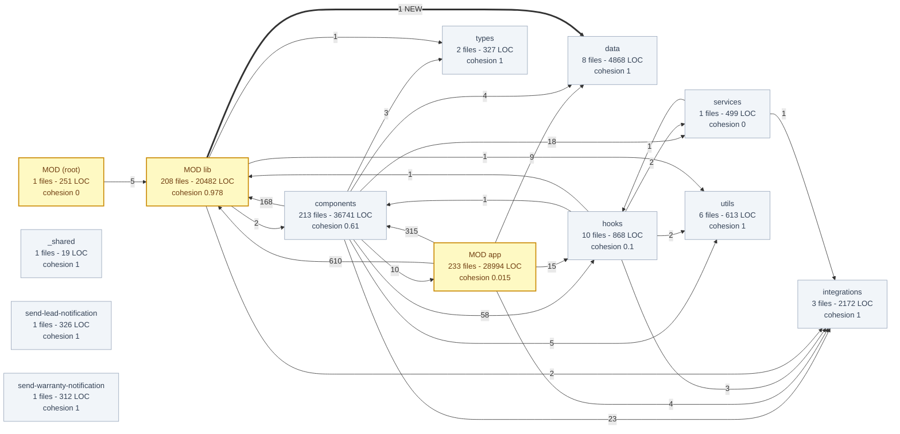

# Codebase map

Generated 2026-10-29T22:13:45.661Z from commit `9fd791b` on `chore/codemap-refresh`.
Last commit: Merge pull request #113 from lavacagc/fix/sitemap-route-handler

> Compared against `git HEAD:.codemap/snapshot.json` (commit `ea86eda`).

## At a glance

| Metric | Now | Before | Delta |
|---|---:|---:|---:|
| Source files | 688 | 685 | +3 |
| Test files | 0 | 0 | 0 |
| Lines of code | 96472 | 96018 | +454 |
| Internal imports | 2048 | 2040 | +8 |
| Modules | 13 | 13 | 0 |
| Entry points | 229 | 228 | +1 |
| External packages | 53 | 53 | 0 |

## What changed in this commit

**New files (4)**

- `src/app/api/sitemap/route.ts` — 13 LOC, module `app`
- `src/lib/articles/socialCopy.ts` — 212 LOC, module `lib`
- `src/lib/sitemap.ts` — 312 LOC, module `lib`
- `src/lib/sitemapXml.ts` — 51 LOC, module `lib`

**Modified files (20)**

- `src/app/api/admin/revalidate/route.ts` — +5 LOC
- `src/app/api/articles/ingest/[id]/publish/route.ts` — +20 LOC
- `src/app/api/cron/publish/route.ts` — +9 LOC
- `src/app/projects/[slug]/page.tsx` — +1 LOC
- `src/lib/articles/catalogPrices.ts` — +5 LOC
- `src/lib/articles/notify.ts` — +15 LOC
- `src/lib/articles/publishFlow.ts` — +5 LOC
- `src/lib/articles/publishGuard.ts` — +13 LOC
- `src/lib/articles/revalidate.ts` — +5 LOC
- `src/lib/articles/schemas.ts` — +1 LOC
- `src/lib/home-services/catalog.ts` — 0 LOC
- `src/lib/home-services/catalogData.ts` — +15 LOC
- `src/lib/home-services/catalogSeed.ts` — 0 LOC
- `src/lib/home-services/countyZips.ts` — +7 LOC
- `src/lib/home-services/i18n.ts` — 0 LOC
- `src/lib/home-services/requests.ts` — 0 LOC
- `src/lib/home-services/requestsAdmin.ts` — +8 LOC
- `src/lib/projects/http.ts` — +6 LOC
- `src/lib/revalidate.ts` — +11 LOC
- `src/middleware.ts` — +12 LOC

**Deleted files (1)**

- `src/app/sitemap.ts`

**New module boundaries crossed (1)**

- `lib` now imports from `data`

## Module map

Green is new in this commit, yellow was modified, dashed red was deleted. Thick arrows are dependency edges that did not exist before.



## File map for changed modules

```mermaid
%% Generated by codebase-cartographer. File level view of changed modules only.
flowchart LR
  subgraph n7367617070["app"]
    n7372632f6170702f61626f75742f706167652e74["about/page.tsx"]:::stable
    n7372632f6170702f61646d696e2f5b2e2e2e6361["[...catchAll]/page.tsx"]:::stable
    n7372632f6170702f61646d696e2f706167652e74["admin/page.tsx"]:::stable
    n7372632f6170702f6170692f61646d696e2f6172["publish/route.ts"]:::stable
    n7372632f6170702f6170692f61646d696e2f6272["sync-suppression/route.ts"]:::stable
    n7372632f6170702f6170692f61646d696e2f636f["apply/route.ts"]:::stable
    n7372632f6170702f6170692f61646d696e2f636f["content-actions/route.ts"]:::stable
    n7372632f6170702f6170692f61646d696e2f636f["stage/route.ts"]:::stable
    n7372632f6170702f6170692f61646d696e2f6372["crew/route.ts"]:::stable
    n7372632f6170702f6170692f61646d696e2f6374["report/route.ts"]:::stable
    n7372632f6170702f6170692f61646d696e2f6374["settings/route.ts"]:::stable
    n7372632f6170702f6170692f61646d696e2f6374["variants/route.ts"]:::stable
    n7372632f6170702f6170692f61646d696e2f6375["customers/route.ts"]:::stable
    n7372632f6170702f6170692f61646d696e2f6461["dashboard/route.ts"]:::stable
    n7372632f6170702f6170692f61646d696e2f656d["[id]/route.ts"]:::stable
    n7372632f6170702f6170692f61646d696e2f656d["emails/route.ts"]:::stable
    n7372632f6170702f6170692f61646d696e2f6573["estimate-email/_schema.ts"]:::stable
    n7372632f6170702f6170692f61646d696e2f6573["leads/route.ts"]:::stable
    n7372632f6170702f6170692f61646d696e2f6573["log/route.ts"]:::stable
    n7372632f6170702f6170692f61646d696e2f6573["preview/route.ts"]:::stable
    n7372632f6170702f6170692f61646d696e2f6573["send/route.ts"]:::stable
    n7372632f6170702f6170692f61646d696e2f6578["[key]/route.ts"]:::stable
    n7372632f6170702f6170692f61646d696e2f6578["experiments/route.ts"]:::stable
    n7372632f6170702f6170692f61646d696e2f666f["follow-ups/route.ts"]:::stable
    n7372632f6170702f6170692f61646d696e2f686f["home-records/route.ts"]:::stable
    n7372632f6170702f6170692f61646d696e2f686f["member/route.ts"]:::stable
    n7372632f6170702f6170692f61646d696e2f686f["parse-amazon/route.ts"]:::stable
    n7372632f6170702f6170692f61646d696e2f686f["product-image/route.ts"]:::stable
    n7372632f6170702f6170692f61646d696e2f686f["[id]/route.ts"]:::stable
    n7372632f6170702f6170692f61646d696e2f686f["products/route.ts"]:::stable
    n7372632f6170702f6170692f61646d696e2f686f["[slug]/route.ts"]:::stable
    n7372632f6170702f6170692f61646d696e2f686f["home-services/route.ts"]:::stable
    n7372632f6170702f6170692f61646d696e2f6c65["intake/route.ts"]:::stable
    n7372632f6170702f6170692f61646d696e2f6f66["[id]/route.ts"]:::stable
    n7372632f6170702f6170692f61646d696e2f6f66["[id]/route.ts"]:::stable
    n7372632f6170702f6170692f61646d696e2f6f66["[id]/route.ts"]:::stable
    n7372632f6170702f6170692f61646d696e2f6f66["responses/route.ts"]:::stable
    n7372632f6170702f6170692f61646d696e2f6f66["offers/route.ts"]:::stable
    n7372632f6170702f6170692f61646d696e2f7072["preferences/route.ts"]:::stable
    n7372632f6170702f6170692f61646d696e2f7072["pricing-report/route.ts"]:::stable
    n7372632f6170702f6170692f61646d696e2f7072["publish/route.ts"]:::stable
    n7372632f6170702f6170692f61646d696e2f7072["[id]/route.ts"]:::stable
    n7372632f6170702f6170692f61646d696e2f7072["unpublish/route.ts"]:::stable
    n7372632f6170702f6170692f61646d696e2f7072["bulk/route.ts"]:::stable
    n7372632f6170702f6170692f61646d696e2f7072["draft-photos/route.ts"]:::stable
    n7372632f6170702f6170692f61646d696e2f7072["projects/route.ts"]:::stable
    n7372632f6170702f6170692f61646d696e2f7072["upload/route.ts"]:::stable
    n7372632f6170702f6170692f61646d696e2f7072["proposal-categories/route.ts"]:::stable
    n7372632f6170702f6170692f61646d696e2f7072["[id]/route.ts"]:::stable
    n7372632f6170702f6170692f61646d696e2f7072["proposals/route.ts"]:::stable
    n7372632f6170702f6170692f61646d696e2f7265["releases/route.ts"]:::stable
    n7372632f6170702f6170692f61646d696e2f7265["send/route.ts"]:::stable
    n7372632f6170702f6170692f61646d696e2f7265["MOD revalidate/route.ts"]:::changed
    n7372632f6170702f6170692f61646d696e2f7365["service-quote/_schema.ts"]:::stable
    n7372632f6170702f6170692f61646d696e2f7365["complete/route.ts"]:::stable
    n7372632f6170702f6170692f61646d696e2f7365["dispatch/route.ts"]:::stable
    n7372632f6170702f6170692f61646d696e2f7365["intake/route.ts"]:::stable
    n7372632f6170702f6170692f61646d696e2f7365["schedule/route.ts"]:::stable
    n7372632f6170702f6170692f61646d696e2f7365["send/route.ts"]:::stable
    n7372632f6170702f6170692f61646d696e2f7365["[id]/route.ts"]:::stable
    n7372632f6170702f6170692f61646d696e2f7365["service-requests/route.ts"]:::stable
    n7372632f6170702f6170692f61646d696e2f7375["subs/route.ts"]:::stable
    n7372632f6170702f6170692f61727469636c6573["MOD publish/route.ts"]:::changed
    n7372632f6170702f6170692f61727469636c6573["[id]/route.ts"]:::stable
    n7372632f6170702f6170692f61727469636c6573["unpublish/route.ts"]:::stable
    n7372632f6170702f6170692f61727469636c6573["ingest/route.ts"]:::stable
    n7372632f6170702f6170692f61727469636c6573["seo-feedback/route.ts"]:::stable
    n7372632f6170702f6170692f61727469636c6573["[token]/route.ts"]:::stable
    n7372632f6170702f6170692f62616e6e6572732f["admin/route.ts"]:::stable
    n7372632f6170702f6170692f62616e6e6572732f["banners/route.ts"]:::stable
    n7372632f6170702f6170692f6275792d616e642d["unsubscribe/route.ts"]:::stable
    n7372632f6170702f6170692f636f6e73656e742f["log/route.ts"]:::stable
    n7372632f6170702f6170692f637265772f636f6e["confirm/route.ts"]:::stable
    n7372632f6170702f6170692f63726f6e2f657870["experiments-evaluate/route.ts"]:::stable
    n7372632f6170702f6170692f63726f6e2f686561["health/route.ts"]:::stable
    n7372632f6170702f6170692f63726f6e2f686f6d["home-care-newsletter/route.ts"]:::stable
    n7372632f6170702f6170692f63726f6e2f696e74["intake-chase/route.ts"]:::stable
    n7372632f6170702f6170692f63726f6e2f6d6f6e["monthly-newsletter/route.ts"]:::stable
    n7372632f6170702f6170692f63726f6e2f6f6666["offers-expire/route.ts"]:::stable
    n7372632f6170702f6170692f63726f6e2f707562["MOD publish/route.ts"]:::changed
    n7372632f6170702f6170692f63726f6e2f707572["purge-draft-photos/route.ts"]:::stable
    n7372632f6170702f6170692f63726f6e2f726573["resend-sync/route.ts"]:::stable
    n7372632f6170702f6170692f63726f6e2f73656e["send-follow-ups/route.ts"]:::stable
    n7372632f6170702f6170692f63726f6e2f73656f["seo-ingest/route.ts"]:::stable
    n7372632f6170702f6170692f63726f6e2f73656f["seo-report/route.ts"]:::stable
    n7372632f6170702f6170692f63726f6e2f73656f["seo-rollback/route.ts"]:::stable
    n7372632f6170702f6170692f63726f6e2f73656f["seo-suggest/route.ts"]:::stable
    n7372632f6170702f6170692f63726f6e2f73796e["sync-reviews/route.ts"]:::stable
    n7372632f6170702f6170692f63726f6e2f766973["visit-dispatch-escalation/route.ts"]:::stable
    n7372632f6170702f6170692f63726f6e2f766973["visit-reminders/route.ts"]:::stable
    n7372632f6170702f6170692f6374612f6576656e["event/route.ts"]:::stable
    n7372632f6170702f6170692f646f63756d656e74["[type]/route.ts"]:::stable
    n7372632f6170702f6170692f6578706572696d65["conclude/route.ts"]:::stable
    n7372632f6170702f6170692f6578706572696d65["start/route.ts"]:::stable
    n7372632f6170702f6170692f6578706572696d65["backlog/route.ts"]:::stable
    n7372632f6170702f6170692f6578706572696d65["event/route.ts"]:::stable
    n7372632f6170702f6170692f6578706572696d65["notify/route.ts"]:::stable
    n7372632f6170702f6170692f6578706572696d65["report/route.ts"]:::stable
    n7372632f6170702f6170692f6578706572696d65["experiments/route.ts"]:::stable
    n7372632f6170702f6170692f6578706572696d65["veto/route.ts"]:::stable
    n7372632f6170702f6170692f666565646261636b["create/route.ts"]:::stable
    n7372632f6170702f6170692f666f6c6c6f772d75["follow-up/route.ts"]:::stable
    n7372632f6170702f6170692f6865616c74682f66["forms/route.ts"]:::stable
    n7372632f6170702f6170692f686f6d652d636172["access/route.ts"]:::stable
    n7372632f6170702f6170692f686f6d652d636172["login/route.ts"]:::stable
    n7372632f6170702f6170692f686f6d652d636172["profile/route.ts"]:::stable
    n7372632f6170702f6170692f686f6d652d636172["record/route.ts"]:::stable
    n7372632f6170702f6170692f686f6d652d636172["subscribe/route.ts"]:::stable
    n7372632f6170702f6170692f686f6d652d636172["task/route.ts"]:::stable
    n7372632f6170702f6170692f686f6d652d636172["unsubscribe/route.ts"]:::stable
    n7372632f6170702f6170692f686f6d652d636172["verify/route.ts"]:::stable
    n7372632f6170702f6170692f686f6d652d636172["visit.ics/route.ts"]:::stable
    n7372632f6170702f6170692f686f6d652d736572["photos/route.ts"]:::stable
    n7372632f6170702f6170692f686f6d652d736572["request/route.ts"]:::stable
    n7372632f6170702f6170692f686f6d652d736572["resend/route.ts"]:::stable
    n7372632f6170702f6170692f686f6d652d736572["verify/route.ts"]:::stable
    n7372632f6170702f6170692f696e74616b652f5b["answer/route.ts"]:::stable
    n7372632f6170702f6170692f696e74616b652f5b["message/route.ts"]:::stable
    n7372632f6170702f6170692f696e74616b652f5b["photo/route.ts"]:::stable
    n7372632f6170702f6170692f6c656164732f6c69["list/route.ts"]:::stable
    n7372632f6170702f6170692f6c656164732f7375["submit/route.ts"]:::stable
    n7372632f6170702f6170692f6c656164732f7765["webhook/route.ts"]:::stable
    n7372632f6170702f6170692f6e6577736c657474["subscribe/route.ts"]:::stable
    n7372632f6170702f6170692f6e6f746966792f66["form-error/route.ts"]:::stable
    n7372632f6170702f6170692f6e6f746966792f6e["new-lead/route.ts"]:::stable
    n7372632f6170702f6170692f6e6f746966792f74["telegram-lead/route.ts"]:::stable
    n7372632f6170702f6170692f6f66666572732f5b["[token]/route.ts"]:::stable
    n7372632f6170702f6170692f707265666572656e["preferences/route.ts"]:::stable
    n7372632f6170702f6170692f707265666572656e["unsubscribe-by-email/route.ts"]:::stable
    n7372632f6170702f6170692f707265666572656e["unsubscribe/route.ts"]:::stable
    n7372632f6170702f6170692f70726f6a65637473["publish/route.ts"]:::stable
    n7372632f6170702f6170692f70726f6a65637473["[id]/route.ts"]:::stable
    n7372632f6170702f6170692f70726f6a65637473["ingest/route.ts"]:::stable
    n7372632f6170702f6170692f70726f6a65637473["uploads/route.ts"]:::stable
    n7372632f6170702f6170692f70726f706f73616c["submit/route.ts"]:::stable
    n7372632f6170702f6170692f726566657272616c["referrals/route.ts"]:::stable
    n7372632f6170702f6170692f736974656d61702f["NEW sitemap/route.ts"]:::added
    n7372632f6170702f6170692f776562686f6f6b73["resend/route.ts"]:::stable
    n7372632f6170702f61727469636c65732f756e70["[token]/route.ts"]:::stable
    n7372632f6170702f617574682f6c61796f75742e["auth/layout.tsx"]:::stable
    n7372632f6170702f617574682f706167652e7473["auth/page.tsx"]:::stable
    n7372632f6170702f626c6f672f5b736c75675d2f["[slug]/layout.tsx"]:::stable
    n7372632f6170702f626c6f672f5b736c75675d2f["[slug]/page.tsx"]:::stable
    n7372632f6170702f626c6f672f6c61796f75742e["blog/layout.tsx"]:::stable
    n7372632f6170702f626c6f672f706167652e7473["blog/page.tsx"]:::stable
    n7372632f6170702f626c6f672f70726576696577["[slug]/page.tsx"]:::stable
    n7372632f6170702f626f6e642f706167652e7473["bond/page.tsx"]:::stable
    n7372632f6170702f6272616e642d6b69742f636f["brand-kit/copy-button.tsx"]:::stable
    n7372632f6170702f6272616e642d6b69742f7061["brand-kit/page.tsx"]:::stable
    n7372632f6170702f636d732f5b2e2e2e736c7567["[...slug]/page.tsx"]:::stable
    n7372632f6170702f636f6d6d65726369616c2d73["commercial-services/page.tsx"]:::stable
    n7372632f6170702f636f6e746163742f70616765["contact/page.tsx"]:::stable
    n7372632f6170702f637265772f636f6e6669726d["[token]/CrewConfirmActions.tsx"]:::stable
    n7372632f6170702f637265772f636f6e6669726d["[token]/page.tsx"]:::stable
    n7372632f6170702f646174612d7269676874732f["data-rights/layout.tsx"]:::stable
    n7372632f6170702f646174612d7269676874732f["data-rights/page.tsx"]:::stable
    n7372632f6170702f646f2d6e6f742d73656c6c2f["do-not-sell/layout.tsx"]:::stable
    n7372632f6170702f646f2d6e6f742d73656c6c2f["do-not-sell/page.tsx"]:::stable
    n7372632f6170702f6578706572696d656e74732f["[token]/VetoButton.tsx"]:::stable
    n7372632f6170702f6578706572696d656e74732f["[token]/page.tsx"]:::stable
    n7372632f6170702f6661712f706167652e747378["faq/page.tsx"]:::stable
    n7372632f6170702f667265652d657374696d6174["free-estimate/page.tsx"]:::stable
    n7372632f6170702f686f6d652d636172652f626f["book/page.tsx"]:::stable
    n7372632f6170702f686f6d652d636172652f6368["checklist/page.tsx"]:::stable
    n7372632f6170702f686f6d652d636172652f6775["[season]/page.tsx"]:::stable
    n7372632f6170702f686f6d652d636172652f7061["home-care/page.tsx"]:::stable
    n7372632f6170702f686f6d652d636172652f7365["setup/page.tsx"]:::stable
    n7372632f6170702f686f6d652d636172652f7768["whats-new/page.tsx"]:::stable
    n7372632f6170702f686f6d652d73657276696365["[slug]/page.tsx"]:::stable
    n7372632f6170702f686f6d652d73657276696365["home-services/page.tsx"]:::stable
    n7372632f6170702f696e737572616e63652f7061["insurance/page.tsx"]:::stable
    n7372632f6170702f696e74616b652f5b746f6b65["[token]/IntakeThread.tsx"]:::stable
    n7372632f6170702f696e74616b652f5b746f6b65["[token]/page.tsx"]:::stable
    n7372632f6170702f6c61796f75742e747378["app/layout.tsx"]:::stable
    n7372632f6170702f6c656176652d612d72657669["leave-a-review/page.tsx"]:::stable
    n7372632f6170702f6c6963656e73652f70616765["license/page.tsx"]:::stable
    n7372632f6170702f6c6f636174696f6e732f5b63["[city]/page.tsx"]:::stable
    n7372632f6170702f6c6f636174696f6e732f5b63["[service]/page.tsx"]:::stable
    n7372632f6170702f6c6f636174696f6e732f5b63["services/page.tsx"]:::stable
    n7372632f6170702f6c6f636174696f6e732f6d6f["bathroom-renovation/page.tsx"]:::stable
    n7372632f6170702f6c6f636174696f6e732f7061["locations/page.tsx"]:::stable
    n7372632f6170702f6c6f636174696f6e732f7665["bathroom-renovation/page.tsx"]:::stable
    n7372632f6170702f6c702f626173656d656e742d["basement-finishing/page.tsx"]:::stable
    n7372632f6170702f6c702f62617468726f6f6d2d["bathroom-renovation/page.tsx"]:::stable
    n7372632f6170702f6c702f6b69746368656e2d72["kitchen-remodel/page.tsx"]:::stable
    n7372632f6170702f6e657874646f6f722f63616c["callback/CopyCodeButton.tsx"]:::stable
    n7372632f6170702f6e657874646f6f722f63616c["callback/page.tsx"]:::stable
    n7372632f6170702f6e6f742d666f756e642e7473["app/not-found.tsx [ORPHAN]"]:::orphan
    n7372632f6170702f6f666665722f5b746f6b656e["[token]/OfferActions.tsx"]:::stable
    n7372632f6170702f6f666665722f5b746f6b656e["[token]/page.tsx"]:::stable
    n7372632f6170702f706167652e747378["app/page.tsx"]:::stable
    n7372632f6170702f706f7274666f6c696f2f6c61["portfolio/layout.tsx"]:::stable
    n7372632f6170702f706f7274666f6c696f2f7061["portfolio/page.tsx"]:::stable
    n7372632f6170702f707265666572656e6365732f["preferences/PreferencesClient.tsx"]:::stable
    n7372632f6170702f707265666572656e6365732f["preferences/page.tsx"]:::stable
    n7372632f6170702f707269766163792d706f6c69["privacy-policy/layout.tsx"]:::stable
    n7372632f6170702f707269766163792d706f6c69["privacy-policy/page.tsx"]:::stable
    n7372632f6170702f70726f636573732f6c61796f["process/layout.tsx"]:::stable
    n7372632f6170702f70726f636573732f70616765["process/page.tsx"]:::stable
    n7372632f6170702f70726f6a656374732f5b736c["MOD [slug]/page.tsx"]:::changed
    n7372632f6170702f70726f706f73616c2f5b746f["[token]/ProposalView.tsx"]:::stable
    n7372632f6170702f70726f706f73616c2f5b746f["[token]/page.tsx"]:::stable
    n7372632f6170702f726566657272616c2f706167["referral/page.tsx"]:::stable
    n7372632f6170702f726571756573742d65737469["request-estimate/page.tsx"]:::stable
    n7372632f6170702f7265736f75726365732f5b73["[slug]/page.tsx"]:::stable
    n7372632f6170702f7265736f75726365732f7061["resources/page.tsx"]:::stable
    n7372632f6170702f726576696577732f70616765["reviews/page.tsx"]:::stable
    n7372632f6170702f726f626f74732e7473["app/robots.ts [ORPHAN]"]:::orphan
    n7372632f6170702f73657276696365732f5b736c["[slug]/page.tsx"]:::stable
    n7372632f6170702f73657276696365732f696e74["interior-finishing/page.tsx"]:::stable
    n7372632f6170702f73657276696365732f706167["services/page.tsx"]:::stable
    n7372632f6170702f73657276696365732f77686f["whole-home-remodeling/page.tsx"]:::stable
    n7372632f6170702f737072696e672d72656e6f76["spring-renovation/page.tsx"]:::stable
    n7372632f6170702f7465726d732d616e642d636f["terms-and-conditions/layout.tsx"]:::stable
    n7372632f6170702f7465726d732d616e642d636f["terms-and-conditions/page.tsx"]:::stable
    n7372632f6170702f756e7375622f556e73756243["unsub/UnsubClient.tsx"]:::stable
    n7372632f6170702f756e7375622f706167652e74["unsub/page.tsx"]:::stable
    n7372632f6170702f766163612d6d676d742f6372["crew/page.tsx"]:::stable
    n7372632f6170702f766163612d6d676d742f656d["[id]/page.tsx"]:::stable
    n7372632f6170702f766163612d6d676d742f656d["emails/page.tsx"]:::stable
    n7372632f6170702f766163612d6d676d742f666f["follow-ups/page.tsx"]:::stable
    n7372632f6170702f766163612d6d676d742f686f["home-care-shop/page.tsx"]:::stable
    n7372632f6170702f766163612d6d676d742f686f["home-records/page.tsx"]:::stable
    n7372632f6170702f766163612d6d676d742f6c61["vaca-mgmt/layout.tsx"]:::stable
    n7372632f6170702f766163612d6d676d742f7061["vaca-mgmt/page.tsx"]:::stable
    n7372632f6170702f766163612d6d676d742f7072["preferences/page.tsx"]:::stable
    n7372632f6170702f766163612d6d676d742f7072["proposals/page.tsx"]:::stable
    n7372632f6170702f766163612d6d676d742f7265["releases/page.tsx"]:::stable
    n7372632f6170702f766163612d6d676d742f7365["log/page.tsx"]:::stable
    n7372632f6170702f766163612d6d676d742f7365["send-estimate/page.tsx"]:::stable
    n7372632f6170702f766163612d6d676d742f7365["send-service-quote/page.tsx"]:::stable
    n7372632f6170702f77617272616e74792f6c6179["warranty/layout.tsx"]:::stable
    n7372632f6170702f77617272616e74792f706167["warranty/page.tsx"]:::stable
  end
  subgraph n73676c6962["lib"]
    n7372632f6c69622f616e616c79746963732f6578["analytics/excluded.ts"]:::stable
    n7372632f6c69622f61727469636c65732f616374["articles/actions.ts"]:::stable
    n7372632f6c69622f61727469636c65732f61646d["articles/adminPublish.ts"]:::stable
    n7372632f6c69622f61727469636c65732f617574["articles/auth.ts"]:::stable
    n7372632f6c69622f61727469636c65732f636174["MOD articles/catalogPrices.ts"]:::changed
    n7372632f6c69622f61727469636c65732f636c69["articles/cliCommand.ts"]:::stable
    n7372632f6c69622f61727469636c65732f666171["articles/faqJsonLd.ts"]:::stable
    n7372632f6c69622f61727469636c65732f666565["articles/feedback.ts"]:::stable
    n7372632f6c69622f61727469636c65732f687474["articles/http.ts"]:::stable
    n7372632f6c69622f61727469636c65732f6e6f74["MOD articles/notify.ts"]:::changed
    n7372632f6c69622f61727469636c65732f707562["MOD articles/publishFlow.ts"]:::changed
    n7372632f6c69622f61727469636c65732f707562["MOD articles/publishGuard.ts"]:::changed
    n7372632f6c69622f61727469636c65732f726576["MOD articles/revalidate.ts"]:::changed
    n7372632f6c69622f61727469636c65732f736368["MOD articles/schemas.ts"]:::changed
    n7372632f6c69622f61727469636c65732f736f63["NEW articles/socialCopy.ts"]:::added
    n7372632f6c69622f61727469636c65732f756e70["articles/unpublishPage.ts"]:::stable
    n7372632f6c69622f61727469636c65732f756e70["articles/unpublishToken.ts"]:::stable
    n7372632f6c69622f61727469636c65732f777269["articles/writer.ts"]:::stable
    n7372632f6c69622f62616e6e657252756c65732e["lib/bannerRules.ts"]:::stable
    n7372632f6c69622f626f7446696c7465722e7473["lib/botFilter.ts"]:::stable
    n7372632f6c69622f636c69636b2d66726175642d["lib/click-fraud-detector.ts [ORPHAN]"]:::orphan
    n7372632f6c69622f636d732e7473["lib/cms.ts"]:::stable
    n7372632f6c69622f6373762e7473["lib/csv.ts"]:::stable
    n7372632f6c69622f6374612f4865726f4374612e["cta/HeroCta.tsx"]:::stable
    n7372632f6c69622f6374612f4865726f43746145["cta/HeroCtaEvents.tsx"]:::stable
    n7372632f6c69622f6374612f6163746976655061["cta/activePairs.server.ts"]:::stable
    n7372632f6c69622f6374612f61646d696e2e7365["cta/admin.server.ts"]:::stable
    n7372632f6c69622f6374612f61737369676e2e74["cta/assign.ts"]:::stable
    n7372632f6c69622f6374612f626f6f7473747261["cta/bootstrap.ts"]:::stable
    n7372632f6c69622f6374612f636f6c6f722e7473["cta/color.ts"]:::stable
    n7372632f6c69622f6374612f6865726f53746f72["cta/heroStore.server.ts"]:::stable
    n7372632f6c69622f6374612f687474702e7473["cta/http.ts"]:::stable
    n7372632f6c69622f6374612f7265706f72742e74["cta/report.ts"]:::stable
    n7372632f6c69622f6374612f74797065732e7473["cta/types.ts"]:::stable
    n7372632f6c69622f6374612f76617269616e7473["cta/variants.server.ts"]:::stable
    n7372632f6c69622f6374612f76697369746f722e["cta/visitor.edge.ts"]:::stable
    n7372632f6c69622f6374612f76697369746f722e["cta/visitor.server.ts"]:::stable
    n7372632f6c69622f656d61696c54656d706c6174["lib/emailTemplates.ts"]:::stable
    n7372632f6c69622f656e76436c65616e2e7473["lib/envClean.ts"]:::stable
    n7372632f6c69622f6578706572696d656e74732f["experiments/ExperimentZone.tsx"]:::stable
    n7372632f6c69622f6578706572696d656e74732f["experiments/assign.ts"]:::stable
    n7372632f6c69622f6578706572696d656e74732f["experiments/auth.server.ts"]:::stable
    n7372632f6c69622f6578706572696d656e74732f["experiments/client.ts"]:::stable
    n7372632f6c69622f6578706572696d656e74732f["experiments/currentCopy.ts"]:::stable
    n7372632f6c69622f6578706572696d656e74732f["experiments/decide.server.ts"]:::stable
    n7372632f6c69622f6578706572696d656e74732f["experiments/evaluate.ts"]:::stable
    n7372632f6c69622f6578706572696d656e74732f["experiments/events.server.ts"]:::stable
    n7372632f6c69622f6578706572696d656e74732f["experiments/messages.ts"]:::stable
    n7372632f6c69622f6578706572696d656e74732f["experiments/schedule.ts"]:::stable
    n7372632f6c69622f6578706572696d656e74732f["experiments/schemas.ts"]:::stable
    n7372632f6c69622f6578706572696d656e74732f["experiments/seed.ts"]:::stable
    n7372632f6c69622f6578706572696d656e74732f["experiments/store.server.ts"]:::stable
    n7372632f6c69622f6578706572696d656e74732f["experiments/surfaces.ts"]:::stable
    n7372632f6c69622f6578706572696d656e74732f["experiments/types.ts"]:::stable
    n7372632f6c69622f6578706572696d656e74732f["experiments/vetoLookup.server.ts"]:::stable
    n7372632f6c69622f6578706572696d656e74732f["experiments/vetoToken.ts"]:::stable
    n7372632f6c69622f6578706572696d656e74732f["experiments/withExperiment.server.ts"]:::stable
    n7372632f6c69622f666f6c6c6f777570732f6163["followups/activeDrips.ts"]:::stable
    n7372632f6c69622f666f6c6c6f777570732f666f["followups/followUpsApi.ts"]:::stable
    n7372632f6c69622f67656f2f746965722e7473["geo/tier.ts"]:::stable
    n7372632f6c69622f686f6d652d73657276696365["home-services/adminRoute.ts"]:::stable
    n7372632f6c69622f686f6d652d73657276696365["home-services/attachments.ts"]:::stable
    n7372632f6c69622f686f6d652d73657276696365["home-services/attribution.ts"]:::stable
    n7372632f6c69622f686f6d652d73657276696365["MOD home-services/catalog.ts"]:::changed
    n7372632f6c69622f686f6d652d73657276696365["MOD home-services/catalogData.ts"]:::changed
    n7372632f6c69622f686f6d652d73657276696365["home-services/catalogRow.ts"]:::stable
    n7372632f6c69622f686f6d652d73657276696365["home-services/catalogSchema.ts"]:::stable
    n7372632f6c69622f686f6d652d73657276696365["MOD home-services/catalogSeed.ts"]:::changed
    n7372632f6c69622f686f6d652d73657276696365["home-services/compressImage.ts"]:::stable
    n7372632f6c69622f686f6d652d73657276696365["MOD home-services/countyZips.ts"]:::changed
    n7372632f6c69622f686f6d652d73657276696365["MOD home-services/i18n.ts"]:::changed
    n7372632f6c69622f686f6d652d73657276696365["home-services/lang.ts"]:::stable
    n7372632f6c69622f686f6d652d73657276696365["home-services/offerEmail.ts"]:::stable
    n7372632f6c69622f686f6d652d73657276696365["home-services/offerRules.ts"]:::stable
    n7372632f6c69622f686f6d652d73657276696365["home-services/offerSend.ts"]:::stable
    n7372632f6c69622f686f6d652d73657276696365["home-services/offers.ts"]:::stable
    n7372632f6c69622f686f6d652d73657276696365["home-services/photos.ts"]:::stable
    n7372632f6c69622f686f6d652d73657276696365["home-services/pricing.ts"]:::stable
    n7372632f6c69622f686f6d652d73657276696365["MOD home-services/requests.ts"]:::changed
    n7372632f6c69622f686f6d652d73657276696365["MOD home-services/requestsAdmin.ts"]:::changed
    n7372632f6c69622f686f6d652d73657276696365["home-services/seo.ts"]:::stable
    n7372632f6c69622f686f6d652d73657276696365["home-services/serviceArea.ts"]:::stable
    n7372632f6c69622f686f6d652d73657276696365["home-services/sms.ts"]:::stable
    n7372632f6c69622f686f6d652d73657276696365["home-services/storage.ts"]:::stable
    n7372632f6c69622f686f6d652d73657276696365["home-services/submitRequest.ts"]:::stable
    n7372632f6c69622f686f6d652d73657276696365["home-services/verify.ts"]:::stable
    n7372632f6c69622f686f6d65636172652f616363["homecare/accessCookie.ts"]:::stable
    n7372632f6c69622f686f6d65636172652f616363["homecare/accessErrors.ts"]:::stable
    n7372632f6c69622f686f6d65636172652f616d61["homecare/amazonListing.ts"]:::stable
    n7372632f6c69622f686f6d65636172652f636f73["homecare/cost.ts [ORPHAN]"]:::orphan
    n7372632f6c69622f686f6d65636172652f646973["homecare/dispatch.ts"]:::stable
    n7372632f6c69622f686f6d65636172652f646973["homecare/dispatchAlerts.ts"]:::stable
    n7372632f6c69622f686f6d65636172652f646973["homecare/dispatchEmail.ts"]:::stable
    n7372632f6c69622f686f6d65636172652f656d61["homecare/emailLinks.ts"]:::stable
    n7372632f6c69622f686f6d65636172652f656d61["homecare/emailShell.ts"]:::stable
    n7372632f6c69622f686f6d65636172652f677569["homecare/guides.ts"]:::stable
    n7372632f6c69622f686f6d65636172652f686f6d["homecare/homeRecords.ts"]:::stable
    n7372632f6c69622f686f6d65636172652f686f6d["homecare/homeowners.ts"]:::stable
    n7372632f6c69622f686f6d65636172652f696373["homecare/ics.ts"]:::stable
    n7372632f6c69622f686f6d65636172652f6b6e6f["homecare/knownClient.ts"]:::stable
    n7372632f6c69622f686f6d65636172652f6c6966["homecare/lifecycleEmails.ts"]:::stable
    n7372632f6c69622f686f6d65636172652f6e6577["homecare/newsletter.ts"]:::stable
    n7372632f6c69622f686f6d65636172652f6e6577["homecare/newsletterRun.ts"]:::stable
    n7372632f6c69622f686f6d65636172652f70726f["homecare/productAdmin.ts"]:::stable
    n7372632f6c69622f686f6d65636172652f70726f["homecare/productShelf.ts"]:::stable
    n7372632f6c69622f686f6d65636172652f70726f["homecare/products.ts"]:::stable
    n7372632f6c69622f686f6d65636172652f70726f["homecare/profile.ts"]:::stable
    n7372632f6c69622f686f6d65636172652f726563["homecare/records.ts"]:::stable
    n7372632f6c69622f686f6d65636172652f72656c["homecare/releaseAssets.ts"]:::stable
    n7372632f6c69622f686f6d65636172652f72656c["homecare/releaseEmail.ts"]:::stable
    n7372632f6c69622f686f6d65636172652f726574["homecare/retention.ts"]:::stable
    n7372632f6c69622f686f6d65636172652f736561["homecare/season.ts"]:::stable
    n7372632f6c69622f686f6d65636172652f73656c["homecare/selection.ts"]:::stable
    n7372632f6c69622f686f6d65636172652f736572["homecare/serviceEmails.ts"]:::stable
    n7372632f6c69622f686f6d65636172652f736572["homecare/serviceIntake.ts"]:::stable
    n7372632f6c69622f686f6d65636172652f736572["homecare/serviceScheduling.ts"]:::stable
    n7372632f6c69622f686f6d65636172652f736865["homecare/shelfPosition.ts"]:::stable
    n7372632f6c69622f686f6d65636172652f736967["homecare/signInLink.ts"]:::stable
    n7372632f6c69622f686f6d65636172652f737461["homecare/staffAccess.ts"]:::stable
    n7372632f6c69622f686f6d65636172652f737461["homecare/staffAllowlist.ts"]:::stable
    n7372632f6c69622f686f6d65636172652f746173["homecare/taskChoice.ts"]:::stable
    n7372632f6c69622f686f6d65636172652f766973["homecare/visitSchedule.ts"]:::stable
    n7372632f6c69622f696e74616b652f6368617365["intake/chase.ts"]:::stable
    n7372632f6c69622f696e74616b652f636f6d706c["intake/completionAlert.ts"]:::stable
    n7372632f6c69622f696e74616b652f666c6f772e["intake/flow.ts"]:::stable
    n7372632f6c69622f696e74616b652f6f66665363["intake/offScript.ts"]:::stable
    n7372632f6c69622f696e74616b652f70686f746f["intake/photoDelivery.ts"]:::stable
    n7372632f6c69622f696e74616b652f7072696369["intake/pricing.ts"]:::stable
    n7372632f6c69622f696e74616b652f73636f7269["intake/scoring.ts"]:::stable
    n7372632f6c69622f696e74616b652f7365727669["intake/serviceArea.ts"]:::stable
    n7372632f6c69622f696e74616b652f7365737369["intake/session.ts"]:::stable
    n7372632f6c69622f6a736f6e4c642e7473["lib/jsonLd.ts"]:::stable
    n7372632f6c69622f6c65616453616e6974697a65["lib/leadSanitize.ts"]:::stable
    n7372632f6c69622f6c65616453636f72696e672e["lib/leadScoring.ts"]:::stable
    n7372632f6c69622f6c697374696e67732f616363["listings/accessCookie.ts"]:::stable
    n7372632f6c69622f6c697374696e67732f737562["listings/subscribers.ts"]:::stable
    n7372632f6c69622f6d61736b456d61696c2e7473["lib/maskEmail.ts"]:::stable
    n7372632f6c69622f6e6f746966792f63616e6365["notify/cancelFollowUps.ts"]:::stable
    n7372632f6c69622f6e6f746966792f666f726d45["notify/formErrorAlert.ts"]:::stable
    n7372632f6c69622f6e6f746966792f666f726d61["notify/formatContactTime.ts"]:::stable
    n7372632f6c69622f6e6f746966792f6c65616446["notify/leadFollowUp.ts"]:::stable
    n7372632f6c69622f6e6f746966792f6d6f6e7468["notify/monthlyNewsletterEmail.ts"]:::stable
    n7372632f6c69622f6e6f746966792f6e65774c65["notify/newLeadEmail.ts"]:::stable
    n7372632f6c69622f6e6f746966792f7265646163["notify/redactEmailBody.ts"]:::stable
    n7372632f6c69622f6e6f746966792f726573656e["notify/resendAudience.ts"]:::stable
    n7372632f6c69622f6e6f746966792f73656e6445["notify/sendEmail.ts"]:::stable
    n7372632f6c69622f6e6f746966792f73656e6445["notify/sendEstimateEmail.ts"]:::stable
    n7372632f6c69622f6e6f746966792f73656e6448["notify/sendHomeCareEmails.ts"]:::stable
    n7372632f6c69622f6e6f746966792f73656e6452["notify/sendRollbackDigestEmail.ts"]:::stable
    n7372632f6c69622f6e6f746966792f73656e6453["notify/sendSeoReportEmail.ts"]:::stable
    n7372632f6c69622f6e6f746966792f73656e6453["notify/sendStagedDraftEmail.ts"]:::stable
    n7372632f6c69622f6e6f746966792f73656e6465["notify/senders.ts"]:::stable
    n7372632f6c69622f6e6f746966792f7375706162["notify/supabase-rest.ts"]:::stable
    n7372632f6c69622f6e6f746966792f74656c6567["notify/telegramLead.ts"]:::stable
    n7372632f6c69622f6e6f746966792f74656c6567["notify/telegramMessage.ts"]:::stable
    n7372632f6c69622f6f6e655461704c696e6b5365["lib/oneTapLinkSecret.ts"]:::stable
    n7372632f6c69622f707265666572656e6365732f["preferences/preferences.ts"]:::stable
    n7372632f6c69622f707265666572656e6365732f["preferences/streams.ts"]:::stable
    n7372632f6c69622f707269766174655061676573["lib/privatePages.ts"]:::stable
    n7372632f6c69622f70726f6a656374732f646174["projects/dates.ts"]:::stable
    n7372632f6c69622f70726f6a656374732f647261["projects/draft.ts"]:::stable
    n7372632f6c69622f70726f6a656374732f666965["projects/fields.ts"]:::stable
    n7372632f6c69622f70726f6a656374732f67616c["projects/gallery.ts"]:::stable
    n7372632f6c69622f70726f6a656374732f687474["MOD projects/http.ts"]:::changed
    n7372632f6c69622f70726f6a656374732f696e67["projects/ingest.ts"]:::stable
    n7372632f6c69622f70726f6a656374732f696e67["projects/ingestAuth.ts"]:::stable
    n7372632f6c69622f70726f6a656374732f6d6564["projects/media.ts"]:::stable
    n7372632f6c69622f70726f6a656374732f736573["projects/session.ts"]:::stable
    n7372632f6c69622f70726f6a656374732f736c75["projects/slug.ts"]:::stable
    n7372632f6c69622f70726f6a656374732f73746f["projects/storage.ts"]:::stable
    n7372632f6c69622f70726f6a656374732f75706c["projects/uploads.ts"]:::stable
    n7372632f6c69622f70726f706f73616c732f6275["proposals/builderCategories.ts"]:::stable
    n7372632f6c69622f70726f706f73616c732f6275["proposals/bundles.ts"]:::stable
    n7372632f6c69622f70726f706f73616c732f6361["proposals/categories.ts"]:::stable
    n7372632f6c69622f70726f706f73616c732f636c["proposals/clientPage.ts"]:::stable
    n7372632f6c69622f70726f706f73616c732f6373["proposals/csv.ts"]:::stable
    n7372632f6c69622f70726f706f73616c732f6465["proposals/deliveryEmail.ts"]:::stable
    n7372632f6c69622f70726f706f73616c732f6c69["proposals/linkWindow.ts"]:::stable
    n7372632f6c69622f70726f706f73616c732f6d6f["proposals/money.ts"]:::stable
    n7372632f6c69622f70726f706f73616c732f6f77["proposals/ownerAlert.ts"]:::stable
    n7372632f6c69622f70726f706f73616c732f7075["proposals/publicView.ts"]:::stable
    n7372632f6c69622f70726f706f73616c732f7374["proposals/store.ts"]:::stable
    n7372632f6c69622f70726f706f73616c732f7375["proposals/submit.ts"]:::stable
    n7372632f6c69622f70726f706f73616c732f746f["proposals/token.ts"]:::stable
    n7372632f6c69622f726174654c696d69742e7473["lib/rateLimit.ts"]:::stable
    n7372632f6c69622f7265636170746368612d636f["lib/recaptcha-config.ts"]:::stable
    n7372632f6c69622f726563617074636861566572["lib/recaptchaVerify.ts"]:::stable
    n7372632f6c69622f726576616c69646174652e74["MOD lib/revalidate.ts"]:::changed
    n7372632f6c69622f726576696577732f73796e63["reviews/syncGoogleReviews.ts"]:::stable
    n7372632f6c69622f73656f2f6472616674477561["seo/draftGuardrails.ts"]:::stable
    n7372632f6c69622f73656f2f6761342d636c6965["seo/ga4-client.ts"]:::stable
    n7372632f6c69622f73656f2f676f6f676c652d61["seo/google-auth.ts"]:::stable
    n7372632f6c69622f73656f2f6773632d636c6965["seo/gsc-client.ts"]:::stable
    n7372632f6c69622f73656f2f7265706f72742e74["seo/report.ts"]:::stable
    n7372632f6c69622f73656f2f7265706f7274456d["seo/reportEmail.ts"]:::stable
    n7372632f6c69622f73656f2f726f6c6c6261636b["seo/rollback.ts"]:::stable
    n7372632f6c69622f73656f2f73636f72696e672e["seo/scoring.ts"]:::stable
    n7372632f6c69622f73656f2f7374616765546f42["seo/stageToBlog.ts"]:::stable
    n7372632f6c69622f73656f2f7375706162617365["seo/supabase-rest.ts"]:::stable
    n7372632f6c69622f73656f2f75726c2e7473["seo/url.ts"]:::stable
    n7372632f6c69622f736974656d61702e7473["NEW lib/sitemap.ts"]:::added
    n7372632f6c69622f736974656d6170586d6c2e74["NEW lib/sitemapXml.ts"]:::added
    n7372632f6c69622f737065636e6f6f6b2f636c69["specnook/client.ts"]:::stable
    n7372632f6c69622f7375626d69744c6561642e74["lib/submitLead.ts"]:::stable
    n7372632f6c69622f73757061626173652d736572["lib/supabase-server.ts"]:::stable
    n7372632f6c69622f73757061626173652f636c69["supabase/client.ts [ORPHAN]"]:::orphan
    n7372632f6c69622f73757061626173652f736572["supabase/server.ts"]:::stable
    n7372632f6c69622f7574696c732e7473["lib/utils.ts"]:::stable
  end
  subgraph n736728726f6f7429["(root)"]
    n7372632f6d6964646c65776172652e7473["MOD src/middleware.ts"]:::changed
  end
  n676f6e653a7372632f6170702f736974656d6170["DELETED app/sitemap.ts"]:::removed
  n7372632f6170702f6170692f61646d696e2f6172 --> n7372632f6c69622f70726f6a656374732f687474
  n7372632f6170702f6170692f61646d696e2f6172 --> n7372632f6c69622f70726f6a656374732f736573
  n7372632f6170702f6170692f61646d696e2f6172 --> n7372632f6c69622f61727469636c65732f687474
  n7372632f6170702f6170692f61646d696e2f6172 --> n7372632f6c69622f61727469636c65732f707562
  n7372632f6170702f6170692f61646d696e2f6172 --> n7372632f6c69622f61727469636c65732f726576
  n7372632f6170702f6170692f61646d696e2f6172 --> n7372632f6c69622f61727469636c65732f777269
  n7372632f6170702f6170692f61646d696e2f6272 --> n7372632f6c69622f6e6f746966792f726573656e
  n7372632f6170702f6170692f61646d696e2f636f --> n7372632f6c69622f61727469636c65732f616374
  n7372632f6170702f6170692f61646d696e2f636f --> n7372632f6c69622f61727469636c65732f726576
  n7372632f6170702f6170692f61646d696e2f636f --> n7372632f6c69622f61727469636c65732f777269
  n7372632f6170702f6170692f61646d696e2f636f --> n7372632f6c69622f73656f2f7375706162617365
  n7372632f6170702f6170692f61646d696e2f636f --> n7372632f6c69622f73656f2f7375706162617365
  n7372632f6170702f6170692f61646d696e2f636f --> n7372632f6c69622f73656f2f7374616765546f42
  n7372632f6170702f6170692f61646d696e2f636f --> n7372632f6c69622f6e6f746966792f73656e6453
  n7372632f6170702f6170692f61646d696e2f6372 --> n7372632f6c69622f6e6f746966792f7375706162
  n7372632f6170702f6170692f61646d696e2f6374 --> n7372632f6c69622f6374612f61646d696e2e7365
  n7372632f6170702f6170692f61646d696e2f6374 --> n7372632f6c69622f6374612f61646d696e2e7365
  n7372632f6170702f6170692f61646d696e2f6374 --> n7372632f6c69622f6374612f687474702e7473
  n7372632f6170702f6170692f61646d696e2f6374 --> n7372632f6c69622f6e6f746966792f7375706162
  n7372632f6170702f6170692f61646d696e2f6374 --> n7372632f6c69622f6374612f61646d696e2e7365
  n7372632f6170702f6170692f61646d696e2f6374 --> n7372632f6c69622f6374612f6865726f53746f72
  n7372632f6170702f6170692f61646d696e2f6374 --> n7372632f6c69622f6374612f687474702e7473
  n7372632f6170702f6170692f61646d696e2f6374 --> n7372632f6c69622f6374612f74797065732e7473
  n7372632f6170702f6170692f61646d696e2f6374 --> n7372632f6c69622f6578706572696d656e74732f
  n7372632f6170702f6170692f61646d696e2f6374 --> n7372632f6c69622f6578706572696d656e74732f
  n7372632f6170702f6170692f61646d696e2f6375 --> n7372632f6c69622f6c65616453616e6974697a65
  n7372632f6170702f6170692f61646d696e2f656d --> n7372632f6c69622f6e6f746966792f7375706162
  n7372632f6170702f6170692f61646d696e2f656d --> n7372632f6c69622f6e6f746966792f7375706162
  n7372632f6170702f6170692f61646d696e2f656d --> n7372632f6c69622f6e6f746966792f73656e6445
  n7372632f6170702f6170692f61646d696e2f6573 --> n7372632f6c69622f6e6f746966792f7375706162
  n7372632f6170702f6170692f61646d696e2f6573 --> n7372632f6c69622f6e6f746966792f7375706162
  n7372632f6170702f6170692f61646d696e2f6573 --> n7372632f6c69622f656d61696c54656d706c6174
  n7372632f6170702f6170692f61646d696e2f6573 --> n7372632f6170702f6170692f61646d696e2f6573
  n7372632f6170702f6170692f61646d696e2f6573 --> n7372632f6c69622f73757061626173652f736572
  n7372632f6170702f6170692f61646d696e2f6573 --> n7372632f6c69622f6e6f746966792f73656e6445
  n7372632f6170702f6170692f61646d696e2f6573 --> n7372632f6c69622f6e6f746966792f7375706162
  n7372632f6170702f6170692f61646d696e2f6573 --> n7372632f6170702f6170692f61646d696e2f6573
  n7372632f6170702f6170692f61646d696e2f6578 --> n7372632f6c69622f686f6d652d73657276696365
  n7372632f6170702f6170692f61646d696e2f6578 --> n7372632f6c69622f6578706572696d656e74732f
  n7372632f6170702f6170692f61646d696e2f6578 --> n7372632f6c69622f6578706572696d656e74732f
  n7372632f6170702f6170692f61646d696e2f6578 --> n7372632f6c69622f6578706572696d656e74732f
  n7372632f6170702f6170692f61646d696e2f6578 --> n7372632f6c69622f6578706572696d656e74732f
  n7372632f6170702f6170692f61646d696e2f6578 --> n7372632f6c69622f6e6f746966792f7375706162
  n7372632f6170702f6170692f61646d696e2f6578 --> n7372632f6c69622f6578706572696d656e74732f
  n7372632f6170702f6170692f61646d696e2f666f --> n7372632f6c69622f6e6f746966792f63616e6365
  n7372632f6170702f6170692f61646d696e2f686f --> n7372632f6c69622f686f6d65636172652f737461
  n7372632f6170702f6170692f61646d696e2f686f --> n7372632f6c69622f686f6d65636172652f686f6d
  n7372632f6170702f6170692f61646d696e2f686f --> n7372632f6c69622f686f6d65636172652f686f6d
  n7372632f6170702f6170692f61646d696e2f686f --> n7372632f6c69622f686f6d65636172652f726563
  n7372632f6170702f6170692f61646d696e2f686f --> n7372632f6c69622f6e6f746966792f7375706162
  n7372632f6170702f6170692f61646d696e2f686f --> n7372632f6c69622f726174654c696d69742e7473
  n7372632f6170702f6170692f61646d696e2f686f --> n7372632f6c69622f686f6d65636172652f686f6d
  n7372632f6170702f6170692f61646d696e2f686f --> n7372632f6c69622f686f6d65636172652f736967
  n7372632f6170702f6170692f61646d696e2f686f --> n7372632f6c69622f6d61736b456d61696c2e7473
  n7372632f6170702f6170692f61646d696e2f686f --> n7372632f6c69622f6e6f746966792f7375706162
  n7372632f6170702f6170692f61646d696e2f686f --> n7372632f6c69622f686f6d65636172652f70726f
  n7372632f6170702f6170692f61646d696e2f686f --> n7372632f6c69622f686f6d65636172652f616d61
  n7372632f6170702f6170692f61646d696e2f686f --> n7372632f6c69622f686f6d65636172652f70726f
  n7372632f6170702f6170692f61646d696e2f686f --> n7372632f6c69622f6e6f746966792f7375706162
  n7372632f6170702f6170692f61646d696e2f686f --> n7372632f6c69622f686f6d65636172652f70726f
  n7372632f6170702f6170692f61646d696e2f686f --> n7372632f6c69622f6e6f746966792f7375706162
  n7372632f6170702f6170692f61646d696e2f686f --> n7372632f6c69622f686f6d65636172652f70726f
  n7372632f6170702f6170692f61646d696e2f686f --> n7372632f6c69622f686f6d65636172652f70726f
  n7372632f6170702f6170692f61646d696e2f686f --> n7372632f6c69622f6e6f746966792f7375706162
  n7372632f6170702f6170692f61646d696e2f686f --> n7372632f6c69622f686f6d65636172652f70726f
  n7372632f6170702f6170692f61646d696e2f686f --> n7372632f6c69622f686f6d65636172652f70726f
  n7372632f6170702f6170692f61646d696e2f686f --> n7372632f6c69622f6e6f746966792f7375706162
  n7372632f6170702f6170692f61646d696e2f686f --> n7372632f6c69622f686f6d652d73657276696365
  n7372632f6170702f6170692f61646d696e2f686f --> n7372632f6c69622f686f6d652d73657276696365
  n7372632f6170702f6170692f61646d696e2f686f --> n7372632f6c69622f686f6d652d73657276696365
  n7372632f6170702f6170692f61646d696e2f686f --> n7372632f6c69622f686f6d652d73657276696365
  n7372632f6170702f6170692f61646d696e2f686f --> n7372632f6c69622f686f6d652d73657276696365
  n7372632f6170702f6170692f61646d696e2f686f --> n7372632f6c69622f6e6f746966792f7375706162
  n7372632f6170702f6170692f61646d696e2f686f --> n7372632f6c69622f686f6d652d73657276696365
  n7372632f6170702f6170692f61646d696e2f686f --> n7372632f6c69622f686f6d652d73657276696365
  n7372632f6170702f6170692f61646d696e2f6c65 --> n7372632f6c69622f656e76436c65616e2e7473
  n7372632f6170702f6170692f61646d696e2f6c65 --> n7372632f6c69622f6e6f746966792f7375706162
  n7372632f6170702f6170692f61646d696e2f6f66 --> n7372632f6c69622f686f6d652d73657276696365
  n7372632f6170702f6170692f61646d696e2f6f66 --> n7372632f6c69622f686f6d652d73657276696365
  n7372632f6170702f6170692f61646d696e2f6f66 --> n7372632f6c69622f686f6d652d73657276696365
  n7372632f6170702f6170692f61646d696e2f6f66 --> n7372632f6c69622f686f6d652d73657276696365
  n7372632f6170702f6170692f61646d696e2f6f66 --> n7372632f6c69622f6e6f746966792f7375706162
  n7372632f6170702f6170692f61646d696e2f6f66 --> n7372632f6c69622f686f6d652d73657276696365
  n7372632f6170702f6170692f61646d696e2f6f66 --> n7372632f6c69622f686f6d652d73657276696365
  n7372632f6170702f6170692f61646d696e2f6f66 --> n7372632f6c69622f686f6d652d73657276696365
  n7372632f6170702f6170692f61646d696e2f6f66 --> n7372632f6c69622f686f6d652d73657276696365
  n7372632f6170702f6170692f61646d696e2f6f66 --> n7372632f6c69622f6e6f746966792f7375706162
  n7372632f6170702f6170692f61646d696e2f6f66 --> n7372632f6c69622f686f6d652d73657276696365
  n7372632f6170702f6170692f61646d696e2f6f66 --> n7372632f6c69622f686f6d652d73657276696365
  n7372632f6170702f6170692f61646d696e2f6f66 --> n7372632f6c69622f686f6d652d73657276696365
  n7372632f6170702f6170692f61646d696e2f6f66 --> n7372632f6c69622f686f6d652d73657276696365
  n7372632f6170702f6170692f61646d696e2f6f66 --> n7372632f6c69622f686f6d652d73657276696365
  n7372632f6170702f6170692f61646d696e2f6f66 --> n7372632f6c69622f686f6d652d73657276696365
  n7372632f6170702f6170692f61646d696e2f6f66 --> n7372632f6c69622f686f6d652d73657276696365
  n7372632f6170702f6170692f61646d696e2f7072 --> n7372632f6c69622f73757061626173652f736572
  n7372632f6170702f6170692f61646d696e2f7072 --> n7372632f6c69622f6e6f746966792f7375706162
  n7372632f6170702f6170692f61646d696e2f7072 --> n7372632f6c69622f6373762e7473
  n7372632f6170702f6170692f61646d696e2f7072 --> n7372632f6c69622f707265666572656e6365732f
  n7372632f6170702f6170692f61646d696e2f7072 --> n7372632f6c69622f6e6f746966792f7375706162
  n7372632f6170702f6170692f61646d696e2f7072 --> n7372632f6c69622f686f6d652d73657276696365
  n7372632f6170702f6170692f61646d696e2f7072 --> n7372632f6c69622f686f6d652d73657276696365
  n7372632f6170702f6170692f61646d696e2f7072 --> n7372632f6c69622f686f6d652d73657276696365
  n7372632f6170702f6170692f61646d696e2f7072 --> n7372632f6c69622f70726f6a656374732f647261
  n7372632f6170702f6170692f61646d696e2f7072 --> n7372632f6c69622f70726f6a656374732f687474
  n7372632f6170702f6170692f61646d696e2f7072 --> n7372632f6c69622f70726f6a656374732f647261
  n7372632f6170702f6170692f61646d696e2f7072 --> n7372632f6c69622f70726f6a656374732f687474
  n7372632f6170702f6170692f61646d696e2f7072 --> n7372632f6c69622f70726f6a656374732f736573
  n7372632f6170702f6170692f61646d696e2f7072 --> n7372632f6c69622f70726f6a656374732f647261
  n7372632f6170702f6170692f61646d696e2f7072 --> n7372632f6c69622f70726f6a656374732f687474
  n7372632f6170702f6170692f61646d696e2f7072 --> n7372632f6c69622f70726f6a656374732f647261
  n7372632f6170702f6170692f61646d696e2f7072 --> n7372632f6c69622f70726f6a656374732f687474
  n7372632f6170702f6170692f61646d696e2f7072 --> n7372632f6c69622f70726f6a656374732f647261
  n7372632f6170702f6170692f61646d696e2f7072 --> n7372632f6c69622f70726f6a656374732f73746f
  n7372632f6170702f6170692f61646d696e2f7072 --> n7372632f6c69622f70726f6a656374732f647261
  n7372632f6170702f6170692f61646d696e2f7072 --> n7372632f6c69622f70726f6a656374732f687474
  n7372632f6170702f6170692f61646d696e2f7072 --> n7372632f6c69622f70726f6a656374732f736573
  n7372632f6170702f6170692f61646d696e2f7072 --> n7372632f6c69622f70726f6a656374732f647261
  n7372632f6170702f6170692f61646d696e2f7072 --> n7372632f6c69622f70726f6a656374732f666965
  n7372632f6170702f6170692f61646d696e2f7072 --> n7372632f6c69622f70726f6a656374732f687474
  n7372632f6170702f6170692f61646d696e2f7072 --> n7372632f6c69622f70726f6a656374732f75706c
  n7372632f6170702f6170692f61646d696e2f7072 --> n7372632f6c69622f73757061626173652f736572
  n7372632f6170702f6170692f61646d696e2f7072 --> n7372632f6c69622f70726f706f73616c732f6275
  n7372632f6170702f6170692f61646d696e2f7072 --> n7372632f6c69622f6e6f746966792f7375706162
  n7372632f6170702f6170692f61646d696e2f7072 --> n7372632f6c69622f73757061626173652f736572
  n7372632f6170702f6170692f61646d696e2f7072 --> n7372632f6c69622f6e6f746966792f73656e6445
  n7372632f6170702f6170692f61646d696e2f7072 --> n7372632f6c69622f656e76436c65616e2e7473
  n7372632f6170702f6170692f61646d696e2f7072 --> n7372632f6c69622f70726f706f73616c732f7374
  n7372632f6170702f6170692f61646d696e2f7072 --> n7372632f6c69622f70726f706f73616c732f636c
  n7372632f6170702f6170692f61646d696e2f7072 --> n7372632f6c69622f70726f706f73616c732f7075
  n7372632f6170702f6170692f61646d696e2f7072 --> n7372632f6c69622f70726f706f73616c732f6465
  n7372632f6170702f6170692f61646d696e2f7072 --> n7372632f6c69622f70726f706f73616c732f7374
  n7372632f6170702f6170692f61646d696e2f7265 --> n7372632f6c69622f6e6f746966792f7375706162
  n7372632f6170702f6170692f61646d696e2f7265 --> n7372632f6c69622f73757061626173652f736572
  n7372632f6170702f6170692f61646d696e2f7265 --> n7372632f6c69622f6e6f746966792f7375706162
  n7372632f6170702f6170692f61646d696e2f7265 --> n7372632f6c69622f6e6f746966792f73656e6445
  n7372632f6170702f6170692f61646d696e2f7265 --> n7372632f6c69622f6e6f746966792f73656e6448
  n7372632f6170702f6170692f61646d696e2f7265 --> n7372632f6c69622f686f6d65636172652f72656c
  n7372632f6170702f6170692f61646d696e2f7265 --> n7372632f6c69622f686f6d65636172652f72656c
  n7372632f6170702f6170692f61646d696e2f7265 --> n7372632f6c69622f707265666572656e6365732f
  n7372632f6170702f6170692f61646d696e2f7265 --> n7372632f6c69622f70726f6a656374732f687474
  n7372632f6170702f6170692f61646d696e2f7265 --> n7372632f6c69622f726576616c69646174652e74
  n7372632f6170702f6170692f61646d696e2f7365 --> n7372632f6c69622f6e6f746966792f7375706162
  n7372632f6170702f6170692f61646d696e2f7365 --> n7372632f6c69622f6e6f746966792f73656e6445
  n7372632f6170702f6170692f61646d696e2f7365 --> n7372632f6c69622f6e6f746966792f73656e6448
  n7372632f6170702f6170692f61646d696e2f7365 --> n7372632f6c69622f686f6d65636172652f736572
  n7372632f6170702f6170692f61646d696e2f7365 --> n7372632f6c69622f686f6d65636172652f656d61
  n7372632f6170702f6170692f61646d696e2f7365 --> n7372632f6c69622f686f6d65636172652f736572
  n7372632f6170702f6170692f61646d696e2f7365 --> n7372632f6c69622f686f6d65636172652f646973
  n7372632f6170702f6170692f61646d696e2f7365 --> n7372632f6c69622f707265666572656e6365732f
  n7372632f6170702f6170692f61646d696e2f7365 --> n7372632f6c69622f656e76436c65616e2e7473
  n7372632f6170702f6170692f61646d696e2f7365 --> n7372632f6170702f6170692f61646d696e2f7365
  n7372632f6170702f6170692f61646d696e2f7365 --> n7372632f6c69622f6e6f746966792f7375706162
  n7372632f6170702f6170692f61646d696e2f7365 --> n7372632f6c69622f686f6d65636172652f646973
  n7372632f6170702f6170692f61646d696e2f7365 --> n7372632f6170702f6170692f61646d696e2f7365
  n7372632f6170702f6170692f61646d696e2f7365 --> n7372632f6c69622f6e6f746966792f7375706162
  n7372632f6170702f6170692f61646d696e2f7365 --> n7372632f6c69622f6e6f746966792f63616e6365
  n7372632f6170702f6170692f61646d696e2f7365 --> n7372632f6c69622f686f6d65636172652f736572
  n7372632f6170702f6170692f61646d696e2f7365 --> n7372632f6c69622f686f6d65636172652f646973
  n7372632f6170702f6170692f61646d696e2f7365 --> n7372632f6c69622f6e6f746966792f7375706162
  n7372632f6170702f6170692f61646d696e2f7365 --> n7372632f6c69622f686f6d65636172652f736572
  n7372632f6170702f6170692f61646d696e2f7365 --> n7372632f6c69622f686f6d65636172652f736572
  n7372632f6170702f6170692f61646d696e2f7365 --> n7372632f6c69622f686f6d65636172652f656d61
  n7372632f6170702f6170692f61646d696e2f7365 --> n7372632f6c69622f686f6d65636172652f646973
  n7372632f6170702f6170692f61646d696e2f7365 --> n7372632f6c69622f686f6d65636172652f766973
  n7372632f6170702f6170692f61646d696e2f7365 --> n7372632f6c69622f686f6d65636172652f686f6d
  n7372632f6170702f6170692f61646d696e2f7365 --> n7372632f6c69622f686f6d65636172652f736561
  n7372632f6170702f6170692f61646d696e2f7365 --> n7372632f6c69622f686f6d65636172652f696373
  n7372632f6170702f6170692f61646d696e2f7365 --> n7372632f6c69622f707265666572656e6365732f
  n7372632f6170702f6170692f61646d696e2f7365 --> n7372632f6c69622f656e76436c65616e2e7473
  n7372632f6170702f6170692f61646d696e2f7365 --> n7372632f6170702f6170692f61646d696e2f7365
  n7372632f6170702f6170692f61646d696e2f7365 --> n7372632f6c69622f73757061626173652f736572
  n7372632f6170702f6170692f61646d696e2f7365 --> n7372632f6c69622f6e6f746966792f7375706162
  n7372632f6170702f6170692f61646d696e2f7365 --> n7372632f6c69622f6e6f746966792f73656e6445
  n7372632f6170702f6170692f61646d696e2f7365 --> n7372632f6c69622f6e6f746966792f73656e6448
  n7372632f6170702f6170692f61646d696e2f7365 --> n7372632f6c69622f686f6d65636172652f736572
  n7372632f6170702f6170692f61646d696e2f7365 --> n7372632f6c69622f707265666572656e6365732f
  n7372632f6170702f6170692f61646d696e2f7365 --> n7372632f6c69622f656e76436c65616e2e7473
  n7372632f6170702f6170692f61646d696e2f7365 --> n7372632f6170702f6170692f61646d696e2f7365
  n7372632f6170702f6170692f61646d696e2f7365 --> n7372632f6c69622f6e6f746966792f7375706162
  n7372632f6170702f6170692f61646d696e2f7365 --> n7372632f6c69622f686f6d652d73657276696365
  n7372632f6170702f6170692f61646d696e2f7365 --> n7372632f6c69622f686f6d652d73657276696365
  n7372632f6170702f6170692f61646d696e2f7365 --> n7372632f6c69622f686f6d652d73657276696365
  n7372632f6170702f6170692f61646d696e2f7365 --> n7372632f6c69622f686f6d652d73657276696365
  n7372632f6170702f6170692f61646d696e2f7365 --> n7372632f6c69622f686f6d652d73657276696365
  n7372632f6170702f6170692f61646d696e2f7365 --> n7372632f6c69622f686f6d652d73657276696365
  n7372632f6170702f6170692f61646d696e2f7365 --> n7372632f6c69622f686f6d652d73657276696365
  n7372632f6170702f6170692f61646d696e2f7365 --> n7372632f6c69622f737065636e6f6f6b2f636c69
  n7372632f6170702f6170692f61646d696e2f7365 --> n7372632f6c69622f686f6d652d73657276696365
  n7372632f6170702f6170692f61646d696e2f7365 --> n7372632f6c69622f686f6d652d73657276696365
  n7372632f6170702f6170692f61646d696e2f7365 --> n7372632f6c69622f6578706572696d656e74732f
  n7372632f6170702f6170692f61646d696e2f7365 --> n7372632f6c69622f6e6f746966792f7375706162
  n7372632f6170702f6170692f61646d696e2f7365 --> n7372632f6c69622f686f6d652d73657276696365
  n7372632f6170702f6170692f61646d696e2f7365 --> n7372632f6c69622f686f6d652d73657276696365
  n7372632f6170702f6170692f61646d696e2f7365 --> n7372632f6c69622f686f6d652d73657276696365
  n7372632f6170702f6170692f61646d696e2f7375 --> n7372632f6c69622f6e6f746966792f7375706162
  n7372632f6170702f6170692f61646d696e2f7375 --> n7372632f6c69622f686f6d652d73657276696365
  n7372632f6170702f6170692f61646d696e2f7375 --> n7372632f6c69622f686f6d652d73657276696365
  n7372632f6170702f6170692f61646d696e2f7375 --> n7372632f6c69622f686f6d652d73657276696365
  n7372632f6170702f6170692f61646d696e2f7375 --> n7372632f6c69622f737065636e6f6f6b2f636c69
  n7372632f6170702f6170692f61646d696e2f7375 --> n7372632f6c69622f686f6d652d73657276696365
  n7372632f6170702f6170692f61727469636c6573 --> n7372632f6c69622f70726f6a656374732f687474
  n7372632f6170702f6170692f61727469636c6573 --> n7372632f6c69622f61727469636c65732f616374
  n7372632f6170702f6170692f61727469636c6573 --> n7372632f6c69622f61727469636c65732f617574
  n7372632f6170702f6170692f61727469636c6573 --> n7372632f6c69622f61727469636c65732f687474
  n7372632f6170702f6170692f61727469636c6573 --> n7372632f6c69622f61727469636c65732f707562
  n7372632f6170702f6170692f61727469636c6573 ==> n7372632f6c69622f61727469636c65732f707562
  n7372632f6170702f6170692f61727469636c6573 ==> n7372632f6c69622f61727469636c65732f736f63
  n7372632f6170702f6170692f61727469636c6573 --> n7372632f6c69622f73656f2f6472616674477561
  n7372632f6170702f6170692f61727469636c6573 --> n7372632f6c69622f61727469636c65732f726576
  n7372632f6170702f6170692f61727469636c6573 --> n7372632f6c69622f61727469636c65732f736368
  n7372632f6170702f6170692f61727469636c6573 --> n7372632f6c69622f61727469636c65732f777269
  n7372632f6170702f6170692f61727469636c6573 --> n7372632f6c69622f70726f6a656374732f687474
  n7372632f6170702f6170692f61727469636c6573 --> n7372632f6c69622f61727469636c65732f616374
  n7372632f6170702f6170692f61727469636c6573 --> n7372632f6c69622f61727469636c65732f617574
  n7372632f6170702f6170692f61727469636c6573 --> n7372632f6c69622f61727469636c65732f687474
  n7372632f6170702f6170692f61727469636c6573 --> n7372632f6c69622f61727469636c65732f707562
  n7372632f6170702f6170692f61727469636c6573 --> n7372632f6c69622f61727469636c65732f726576
  n7372632f6170702f6170692f61727469636c6573 --> n7372632f6c69622f61727469636c65732f736368
  n7372632f6170702f6170692f61727469636c6573 --> n7372632f6c69622f61727469636c65732f777269
  n7372632f6170702f6170692f61727469636c6573 --> n7372632f6c69622f61727469636c65732f617574
  n7372632f6170702f6170692f61727469636c6573 --> n7372632f6c69622f61727469636c65732f726576
  n7372632f6170702f6170692f61727469636c6573 --> n7372632f6c69622f61727469636c65732f777269
  n7372632f6170702f6170692f61727469636c6573 --> n7372632f6c69622f70726f6a656374732f687474
  n7372632f6170702f6170692f61727469636c6573 --> n7372632f6c69622f61727469636c65732f616374
  n7372632f6170702f6170692f61727469636c6573 --> n7372632f6c69622f61727469636c65732f617574
  n7372632f6170702f6170692f61727469636c6573 --> n7372632f6c69622f61727469636c65732f687474
  n7372632f6170702f6170692f61727469636c6573 --> n7372632f6c69622f61727469636c65732f736368
  n7372632f6170702f6170692f61727469636c6573 --> n7372632f6c69622f61727469636c65732f777269
  n7372632f6170702f6170692f61727469636c6573 --> n7372632f6c69622f61727469636c65732f616374
  n7372632f6170702f6170692f61727469636c6573 --> n7372632f6c69622f61727469636c65732f617574
  n7372632f6170702f6170692f61727469636c6573 --> n7372632f6c69622f61727469636c65732f666565
  n7372632f6170702f6170692f61727469636c6573 --> n7372632f6c69622f61727469636c65732f736368
  n7372632f6170702f6170692f61727469636c6573 --> n7372632f6c69622f73656f2f7265706f72742e74
  n7372632f6170702f6170692f61727469636c6573 --> n7372632f6c69622f686f6d652d73657276696365
  n7372632f6170702f6170692f61727469636c6573 --> n7372632f6c69622f73656f2f7375706162617365
  n7372632f6170702f6170692f61727469636c6573 --> n7372632f6c69622f726174654c696d69742e7473
  n7372632f6170702f6170692f61727469636c6573 --> n7372632f6c69622f70726f6a656374732f687474
  n7372632f6170702f6170692f61727469636c6573 --> n7372632f6c69622f61727469636c65732f6e6f74
  n7372632f6170702f6170692f61727469636c6573 --> n7372632f6c69622f61727469636c65732f707562
  n7372632f6170702f6170692f61727469636c6573 --> n7372632f6c69622f61727469636c65732f726576
  n7372632f6170702f6170692f61727469636c6573 --> n7372632f6c69622f61727469636c65732f756e70
  n7372632f6170702f6170692f61727469636c6573 --> n7372632f6c69622f61727469636c65732f777269
  n7372632f6170702f6170692f6275792d616e642d --> n7372632f6c69622f6c697374696e67732f737562
  n7372632f6170702f6170692f6275792d616e642d --> n7372632f6c69622f707265666572656e6365732f
  n7372632f6170702f6170692f6275792d616e642d --> n7372632f6c69622f6c697374696e67732f616363
  n7372632f6170702f6170692f636f6e73656e742f --> n7372632f6c69622f6e6f746966792f7375706162
  n7372632f6170702f6170692f636f6e73656e742f --> n7372632f6c69622f6e6f746966792f666f726d45
  n7372632f6170702f6170692f636f6e73656e742f --> n7372632f6c69622f726174654c696d69742e7473
  n7372632f6170702f6170692f637265772f636f6e --> n7372632f6c69622f6e6f746966792f7375706162
  n7372632f6170702f6170692f637265772f636f6e --> n7372632f6c69622f6e6f746966792f74656c6567
  n7372632f6170702f6170692f637265772f636f6e --> n7372632f6c69622f686f6d65636172652f646973
  n7372632f6170702f6170692f637265772f636f6e --> n7372632f6c69622f686f6d65636172652f646973
  n7372632f6170702f6170692f637265772f636f6e --> n7372632f6c69622f686f6d65636172652f736572
  n7372632f6170702f6170692f637265772f636f6e --> n7372632f6c69622f686f6d65636172652f766973
  n7372632f6170702f6170692f637265772f636f6e --> n7372632f6c69622f726174654c696d69742e7473
  n7372632f6170702f6170692f63726f6e2f657870 --> n7372632f6c69622f6578706572696d656e74732f
  n7372632f6170702f6170692f63726f6e2f657870 --> n7372632f6c69622f6578706572696d656e74732f
  n7372632f6170702f6170692f63726f6e2f686f6d --> n7372632f6c69622f656e76436c65616e2e7473
  n7372632f6170702f6170692f63726f6e2f686f6d --> n7372632f6c69622f6e6f746966792f7375706162
  n7372632f6170702f6170692f63726f6e2f686f6d --> n7372632f6c69622f686f6d65636172652f686f6d
  n7372632f6170702f6170692f63726f6e2f686f6d --> n7372632f6c69622f686f6d65636172652f736561
  n7372632f6170702f6170692f63726f6e2f686f6d --> n7372632f6c69622f686f6d65636172652f6e6577
  n7372632f6170702f6170692f63726f6e2f686f6d --> n7372632f6c69622f686f6d65636172652f70726f
  n7372632f6170702f6170692f63726f6e2f686f6d --> n7372632f6c69622f686f6d65636172652f6e6577
  n7372632f6170702f6170692f63726f6e2f686f6d --> n7372632f6c69622f686f6d65636172652f73656c
  n7372632f6170702f6170692f63726f6e2f686f6d --> n7372632f6c69622f6e6f746966792f73656e6448
  n7372632f6170702f6170692f63726f6e2f686f6d --> n7372632f6c69622f707265666572656e6365732f
  n7372632f6170702f6170692f63726f6e2f696e74 --> n7372632f6c69622f6e6f746966792f7375706162
  n7372632f6170702f6170692f63726f6e2f696e74 --> n7372632f6c69622f6e6f746966792f74656c6567
  n7372632f6170702f6170692f63726f6e2f696e74 --> n7372632f6c69622f696e74616b652f6368617365
  n7372632f6170702f6170692f63726f6e2f696e74 --> n7372632f6c69622f696e74616b652f7365737369
  n7372632f6170702f6170692f63726f6e2f6d6f6e --> n7372632f6c69622f656e76436c65616e2e7473
  n7372632f6170702f6170692f63726f6e2f6d6f6e --> n7372632f6c69622f73656f2f7375706162617365
  n7372632f6170702f6170692f63726f6e2f6d6f6e --> n7372632f6c69622f6e6f746966792f73656e6445
  n7372632f6170702f6170692f63726f6e2f6d6f6e --> n7372632f6c69622f707265666572656e6365732f
  n7372632f6170702f6170692f63726f6e2f6d6f6e --> n7372632f6c69622f6e6f746966792f6d6f6e7468
  n7372632f6170702f6170692f63726f6e2f6f6666 --> n7372632f6c69622f686f6d652d73657276696365
  n7372632f6170702f6170692f63726f6e2f707562 --> n7372632f6c69622f61727469636c65732f707562
  n7372632f6170702f6170692f63726f6e2f707562 ==> n7372632f6c69622f61727469636c65732f707562
  n7372632f6170702f6170692f63726f6e2f707562 --> n7372632f6c69622f61727469636c65732f726576
  n7372632f6170702f6170692f63726f6e2f707562 --> n7372632f6c69622f61727469636c65732f777269
  n7372632f6170702f6170692f63726f6e2f707562 --> n7372632f6c69622f70726f6a656374732f687474
  n7372632f6170702f6170692f63726f6e2f707572 --> n7372632f6c69622f6e6f746966792f7375706162
  n7372632f6170702f6170692f63726f6e2f707572 --> n7372632f6c69622f686f6d652d73657276696365
  n7372632f6170702f6170692f63726f6e2f726573 --> n7372632f6c69622f656e76436c65616e2e7473
  n7372632f6170702f6170692f63726f6e2f726573 --> n7372632f6c69622f6e6f746966792f726573656e
  n7372632f6170702f6170692f63726f6e2f73656e --> n7372632f6c69622f6e6f746966792f73656e6445
  n7372632f6170702f6170692f63726f6e2f73656e --> n7372632f6c69622f686f6d65636172652f686f6d
  n7372632f6170702f6170692f63726f6e2f73656e --> n7372632f6c69622f6e6f746966792f63616e6365
  n7372632f6170702f6170692f63726f6e2f73656e --> n7372632f6c69622f656d61696c54656d706c6174
  n7372632f6170702f6170692f63726f6e2f73656f --> n7372632f6c69622f73656f2f6773632d636c6965
  n7372632f6170702f6170692f63726f6e2f73656f --> n7372632f6c69622f73656f2f6761342d636c6965
  n7372632f6170702f6170692f63726f6e2f73656f --> n7372632f6c69622f73656f2f7375706162617365
  n7372632f6170702f6170692f63726f6e2f73656f --> n7372632f6c69622f73656f2f75726c2e7473
  n7372632f6170702f6170692f63726f6e2f73656f --> n7372632f6c69622f73656f2f676f6f676c652d61
  n7372632f6170702f6170692f63726f6e2f73656f --> n7372632f6c69622f73656f2f7375706162617365
  n7372632f6170702f6170692f63726f6e2f73656f --> n7372632f6c69622f73656f2f7265706f72742e74
  n7372632f6170702f6170692f63726f6e2f73656f --> n7372632f6c69622f6e6f746966792f73656e6453
  n7372632f6170702f6170692f63726f6e2f73656f --> n7372632f6c69622f73656f2f7375706162617365
  n7372632f6170702f6170692f63726f6e2f73656f --> n7372632f6c69622f73656f2f726f6c6c6261636b
  n7372632f6170702f6170692f63726f6e2f73656f --> n7372632f6c69622f6e6f746966792f73656e6452
  n7372632f6170702f6170692f63726f6e2f73656f --> n7372632f6c69622f61727469636c65732f726576
  n7372632f6170702f6170692f63726f6e2f73656f --> n7372632f6c69622f73656f2f7375706162617365
  n7372632f6170702f6170692f63726f6e2f73656f --> n7372632f6c69622f73656f2f7265706f72742e74
  n7372632f6170702f6170692f63726f6e2f73656f --> n7372632f6c69622f73656f2f73636f72696e672e
  n7372632f6170702f6170692f63726f6e2f73796e --> n7372632f6c69622f726576696577732f73796e63
  n7372632f6170702f6170692f63726f6e2f73796e --> n7372632f6c69622f6e6f746966792f74656c6567
  n7372632f6170702f6170692f63726f6e2f766973 --> n7372632f6c69622f6e6f746966792f7375706162
  n7372632f6170702f6170692f63726f6e2f766973 --> n7372632f6c69622f6e6f746966792f74656c6567
  n7372632f6170702f6170692f63726f6e2f766973 --> n7372632f6c69622f686f6d65636172652f646973
  n7372632f6170702f6170692f63726f6e2f766973 --> n7372632f6c69622f686f6d65636172652f646973
  n7372632f6170702f6170692f63726f6e2f766973 --> n7372632f6c69622f686f6d65636172652f736572
  n7372632f6170702f6170692f63726f6e2f766973 --> n7372632f6c69622f686f6d65636172652f766973
  n7372632f6170702f6170692f63726f6e2f766973 --> n7372632f6c69622f6e6f746966792f7375706162
  n7372632f6170702f6170692f63726f6e2f766973 --> n7372632f6c69622f6e6f746966792f73656e6445
  n7372632f6170702f6170692f63726f6e2f766973 --> n7372632f6c69622f6e6f746966792f7265646163
  n7372632f6170702f6170692f63726f6e2f766973 --> n7372632f6c69622f6e6f746966792f73656e6448
  n7372632f6170702f6170692f63726f6e2f766973 --> n7372632f6c69622f686f6d65636172652f656d61
  n7372632f6170702f6170692f63726f6e2f766973 --> n7372632f6c69622f686f6d65636172652f736572
  n7372632f6170702f6170692f63726f6e2f766973 --> n7372632f6c69622f686f6d65636172652f766973
  n7372632f6170702f6170692f63726f6e2f766973 --> n7372632f6c69622f707265666572656e6365732f
  n7372632f6170702f6170692f63726f6e2f766973 --> n7372632f6c69622f656e76436c65616e2e7473
  n7372632f6170702f6170692f6374612f6576656e --> n7372632f6c69622f6578706572696d656e74732f
  n7372632f6170702f6170692f6374612f6576656e --> n7372632f6c69622f6374612f6865726f53746f72
  n7372632f6170702f6170692f6374612f6576656e --> n7372632f6c69622f726174654c696d69742e7473
  n7372632f6170702f6170692f6374612f6576656e --> n7372632f6c69622f6374612f687474702e7473
  n7372632f6170702f6170692f6374612f6576656e --> n7372632f6c69622f6374612f6163746976655061
  n7372632f6170702f6170692f6374612f6576656e --> n7372632f6c69622f6374612f76697369746f722e
  n7372632f6170702f6170692f6374612f6576656e --> n7372632f6c69622f6374612f74797065732e7473
  n7372632f6170702f6170692f646f63756d656e74 --> n7372632f6c69622f73757061626173652d736572
  n7372632f6170702f6170692f6578706572696d65 --> n7372632f6c69622f70726f6a656374732f687474
  n7372632f6170702f6170692f6578706572696d65 --> n7372632f6c69622f6578706572696d656e74732f
  n7372632f6170702f6170692f6578706572696d65 --> n7372632f6c69622f6578706572696d656e74732f
  n7372632f6170702f6170692f6578706572696d65 --> n7372632f6c69622f6578706572696d656e74732f
  n7372632f6170702f6170692f6578706572696d65 --> n7372632f6c69622f6578706572696d656e74732f
  n7372632f6170702f6170692f6578706572696d65 --> n7372632f6c69622f6578706572696d656e74732f
  n7372632f6170702f6170692f6578706572696d65 --> n7372632f6c69622f70726f6a656374732f687474
  n7372632f6170702f6170692f6578706572696d65 --> n7372632f6c69622f6578706572696d656e74732f
  n7372632f6170702f6170692f6578706572696d65 --> n7372632f6c69622f6578706572696d656e74732f
  n7372632f6170702f6170692f6578706572696d65 --> n7372632f6c69622f6578706572696d656e74732f
  n7372632f6170702f6170692f6578706572696d65 --> n7372632f6c69622f6578706572696d656e74732f
  n7372632f6170702f6170692f6578706572696d65 --> n7372632f6c69622f70726f6a656374732f687474
  n7372632f6170702f6170692f6578706572696d65 --> n7372632f6c69622f6e6f746966792f7375706162
  n7372632f6170702f6170692f6578706572696d65 --> n7372632f6c69622f6578706572696d656e74732f
  n7372632f6170702f6170692f6578706572696d65 --> n7372632f6c69622f6578706572696d656e74732f
  n7372632f6170702f6170692f6578706572696d65 --> n7372632f6c69622f6578706572696d656e74732f
  n7372632f6170702f6170692f6578706572696d65 --> n7372632f6c69622f726174654c696d69742e7473
  n7372632f6170702f6170692f6578706572696d65 --> n7372632f6c69622f6374612f687474702e7473
  n7372632f6170702f6170692f6578706572696d65 --> n7372632f6c69622f6374612f76697369746f722e
  n7372632f6170702f6170692f6578706572696d65 --> n7372632f6c69622f6374612f74797065732e7473
  n7372632f6170702f6170692f6578706572696d65 --> n7372632f6c69622f626f7446696c7465722e7473
  n7372632f6170702f6170692f6578706572696d65 --> n7372632f6c69622f6578706572696d656e74732f
  n7372632f6170702f6170692f6578706572696d65 --> n7372632f6c69622f6578706572696d656e74732f
  n7372632f6170702f6170692f6578706572696d65 --> n7372632f6c69622f6578706572696d656e74732f
  n7372632f6170702f6170692f6578706572696d65 --> n7372632f6c69622f6578706572696d656e74732f
  n7372632f6170702f6170692f6578706572696d65 --> n7372632f6c69622f70726f6a656374732f687474
  n7372632f6170702f6170692f6578706572696d65 --> n7372632f6c69622f6e6f746966792f74656c6567
  n7372632f6170702f6170692f6578706572696d65 --> n7372632f6c69622f6578706572696d656e74732f
  n7372632f6170702f6170692f6578706572696d65 --> n7372632f6c69622f6578706572696d656e74732f
  n7372632f6170702f6170692f6578706572696d65 --> n7372632f6c69622f6e6f746966792f7375706162
  n7372632f6170702f6170692f6578706572696d65 --> n7372632f6c69622f6578706572696d656e74732f
  n7372632f6170702f6170692f6578706572696d65 --> n7372632f6c69622f6578706572696d656e74732f
  n7372632f6170702f6170692f6578706572696d65 --> n7372632f6c69622f6578706572696d656e74732f
  n7372632f6170702f6170692f6578706572696d65 --> n7372632f6c69622f6578706572696d656e74732f
  n7372632f6170702f6170692f6578706572696d65 --> n7372632f6c69622f70726f6a656374732f687474
  n7372632f6170702f6170692f6578706572696d65 --> n7372632f6c69622f6e6f746966792f7375706162
  n7372632f6170702f6170692f6578706572696d65 --> n7372632f6c69622f6578706572696d656e74732f
  n7372632f6170702f6170692f6578706572696d65 --> n7372632f6c69622f6578706572696d656e74732f
  n7372632f6170702f6170692f6578706572696d65 --> n7372632f6c69622f6578706572696d656e74732f
  n7372632f6170702f6170692f6578706572696d65 --> n7372632f6c69622f6578706572696d656e74732f
  n7372632f6170702f6170692f6578706572696d65 --> n7372632f6c69622f726174654c696d69742e7473
  n7372632f6170702f6170692f6578706572696d65 --> n7372632f6c69622f6374612f687474702e7473
  n7372632f6170702f6170692f6578706572696d65 --> n7372632f6c69622f6578706572696d656e74732f
  n7372632f6170702f6170692f6578706572696d65 --> n7372632f6c69622f6578706572696d656e74732f
  n7372632f6170702f6170692f666565646261636b --> n7372632f6c69622f6e6f746966792f73656e6445
  n7372632f6170702f6170692f666565646261636b --> n7372632f6c69622f656d61696c54656d706c6174
  n7372632f6170702f6170692f666565646261636b --> n7372632f6c69622f656e76436c65616e2e7473
  n7372632f6170702f6170692f666565646261636b --> n7372632f6c69622f707265666572656e6365732f
  n7372632f6170702f6170692f666f6c6c6f772d75 --> n7372632f6c69622f6e6f746966792f63616e6365
  n7372632f6170702f6170692f686f6d652d636172 --> n7372632f6c69622f686f6d65636172652f686f6d
  n7372632f6170702f6170692f686f6d652d636172 --> n7372632f6c69622f686f6d65636172652f656d61
  n7372632f6170702f6170692f686f6d652d636172 --> n7372632f6c69622f686f6d65636172652f616363
  n7372632f6170702f6170692f686f6d652d636172 --> n7372632f6c69622f726174654c696d69742e7473
  n7372632f6170702f6170692f686f6d652d636172 --> n7372632f6c69622f726174654c696d69742e7473
  n7372632f6170702f6170692f686f6d652d636172 --> n7372632f6c69622f726563617074636861566572
  n7372632f6170702f6170692f686f6d652d636172 --> n7372632f6c69622f6d61736b456d61696c2e7473
  n7372632f6170702f6170692f686f6d652d636172 --> n7372632f6c69622f686f6d65636172652f686f6d
  n7372632f6170702f6170692f686f6d652d636172 --> n7372632f6c69622f686f6d65636172652f736967
  n7372632f6170702f6170692f686f6d652d636172 --> n7372632f6c69622f686f6d65636172652f616363
  n7372632f6170702f6170692f686f6d652d636172 --> n7372632f6c69622f686f6d65636172652f686f6d
  n7372632f6170702f6170692f686f6d652d636172 --> n7372632f6c69622f686f6d65636172652f70726f
  n7372632f6170702f6170692f686f6d652d636172 --> n7372632f6c69622f6e6f746966792f7375706162
  n7372632f6170702f6170692f686f6d652d636172 --> n7372632f6c69622f686f6d65636172652f616363
  n7372632f6170702f6170692f686f6d652d636172 --> n7372632f6c69622f686f6d65636172652f686f6d
  n7372632f6170702f6170692f686f6d652d636172 --> n7372632f6c69622f6e6f746966792f7375706162
  n7372632f6170702f6170692f686f6d652d636172 --> n7372632f6c69622f726174654c696d69742e7473
  n7372632f6170702f6170692f686f6d652d636172 --> n7372632f6c69622f686f6d65636172652f726563
  n7372632f6170702f6170692f686f6d652d636172 --> n7372632f6c69622f726174654c696d69742e7473
  n7372632f6170702f6170692f686f6d652d636172 --> n7372632f6c69622f726563617074636861566572
  n7372632f6170702f6170692f686f6d652d636172 --> n7372632f6c69622f686f6d65636172652f686f6d
  n7372632f6170702f6170692f686f6d652d636172 --> n7372632f6c69622f6e6f746966792f73656e6448
  n7372632f6170702f6170692f686f6d652d636172 --> n7372632f6c69622f686f6d65636172652f616363
  n7372632f6170702f6170692f686f6d652d636172 --> n7372632f6c69622f686f6d65636172652f686f6d
  n7372632f6170702f6170692f686f6d652d636172 --> n7372632f6c69622f686f6d65636172652f736561
  n7372632f6170702f6170692f686f6d652d636172 --> n7372632f6c69622f686f6d65636172652f73656c
  n7372632f6170702f6170692f686f6d652d636172 --> n7372632f6c69622f6e6f746966792f7375706162
  n7372632f6170702f6170692f686f6d652d636172 --> n7372632f6c69622f686f6d65636172652f686f6d
  n7372632f6170702f6170692f686f6d652d636172 --> n7372632f6c69622f707265666572656e6365732f
  n7372632f6170702f6170692f686f6d652d636172 --> n7372632f6c69622f686f6d65636172652f686f6d
  n7372632f6170702f6170692f686f6d652d636172 --> n7372632f6c69622f686f6d65636172652f656d61
  n7372632f6170702f6170692f686f6d652d636172 --> n7372632f6c69622f686f6d65636172652f616363
  n7372632f6170702f6170692f686f6d652d636172 --> n7372632f6c69622f6e6f746966792f73656e6448
  n7372632f6170702f6170692f686f6d652d636172 --> n7372632f6c69622f707265666572656e6365732f
  n7372632f6170702f6170692f686f6d652d636172 --> n7372632f6c69622f6e6f746966792f726573656e
  n7372632f6170702f6170692f686f6d652d636172 --> n7372632f6c69622f686f6d65636172652f616363
  n7372632f6170702f6170692f686f6d652d636172 --> n7372632f6c69622f686f6d65636172652f696373
  n7372632f6170702f6170692f686f6d652d736572 --> n7372632f6c69622f726174654c696d69742e7473
  n7372632f6170702f6170692f686f6d652d736572 --> n7372632f6c69622f6e6f746966792f7375706162
  n7372632f6170702f6170692f686f6d652d736572 --> n7372632f6c69622f686f6d652d73657276696365
  n7372632f6170702f6170692f686f6d652d736572 --> n7372632f6c69622f6374612f687474702e7473
  n7372632f6170702f6170692f686f6d652d736572 --> n7372632f6c69622f6c65616453636f72696e672e
  n7372632f6170702f6170692f686f6d652d736572 --> n7372632f6c69622f6c65616453616e6974697a65
  n7372632f6170702f6170692f686f6d652d736572 --> n7372632f6c69622f6e6f746966792f6c65616446
  n7372632f6170702f6170692f686f6d652d736572 --> n7372632f6c69622f6e6f746966792f666f726d45
  n7372632f6170702f6170692f686f6d652d736572 --> n7372632f6c69622f6e6f746966792f7375706162
  n7372632f6170702f6170692f686f6d652d736572 --> n7372632f6c69622f726174654c696d69742e7473
  n7372632f6170702f6170692f686f6d652d736572 --> n7372632f6c69622f726563617074636861566572
  n7372632f6170702f6170692f686f6d652d736572 --> n7372632f6c69622f67656f2f746965722e7473
  n7372632f6170702f6170692f686f6d652d736572 --> n7372632f6c69622f686f6d652d73657276696365
  n7372632f6170702f6170692f686f6d652d736572 --> n7372632f6c69622f686f6d652d73657276696365
  n7372632f6170702f6170692f686f6d652d736572 --> n7372632f6c69622f686f6d652d73657276696365
  n7372632f6170702f6170692f686f6d652d736572 --> n7372632f6c69622f6374612f76697369746f722e
  n7372632f6170702f6170692f686f6d652d736572 --> n7372632f6c69622f6578706572696d656e74732f
  n7372632f6170702f6170692f686f6d652d736572 --> n7372632f6c69622f686f6d652d73657276696365
  n7372632f6170702f6170692f686f6d652d736572 --> n7372632f6c69622f686f6d652d73657276696365
  n7372632f6170702f6170692f686f6d652d736572 --> n7372632f6c69622f686f6d652d73657276696365
  n7372632f6170702f6170692f686f6d652d736572 --> n7372632f6c69622f686f6d652d73657276696365
  n7372632f6170702f6170692f686f6d652d736572 --> n7372632f6c69622f6374612f687474702e7473
  n7372632f6170702f6170692f686f6d652d736572 --> n7372632f6c69622f726174654c696d69742e7473
  n7372632f6170702f6170692f686f6d652d736572 --> n7372632f6c69622f6e6f746966792f7375706162
  n7372632f6170702f6170692f686f6d652d736572 --> n7372632f6c69622f686f6d652d73657276696365
  n7372632f6170702f6170692f686f6d652d736572 --> n7372632f6c69622f686f6d652d73657276696365
  n7372632f6170702f6170692f686f6d652d736572 --> n7372632f6c69622f6374612f687474702e7473
  n7372632f6170702f6170692f686f6d652d736572 --> n7372632f6c69622f726174654c696d69742e7473
  n7372632f6170702f6170692f686f6d652d736572 --> n7372632f6c69622f6e6f746966792f7375706162
  n7372632f6170702f6170692f686f6d652d736572 --> n7372632f6c69622f686f6d652d73657276696365
  n7372632f6170702f6170692f686f6d652d736572 --> n7372632f6c69622f686f6d652d73657276696365
  n7372632f6170702f6170692f686f6d652d736572 --> n7372632f6c69622f686f6d652d73657276696365
  n7372632f6170702f6170692f686f6d652d736572 --> n7372632f6c69622f686f6d652d73657276696365
  n7372632f6170702f6170692f696e74616b652f5b --> n7372632f6c69622f696e74616b652f666c6f772e
  n7372632f6170702f6170692f696e74616b652f5b --> n7372632f6c69622f696e74616b652f7072696369
  n7372632f6170702f6170692f696e74616b652f5b --> n7372632f6c69622f696e74616b652f7365737369
  n7372632f6170702f6170692f696e74616b652f5b --> n7372632f6c69622f696e74616b652f73636f7269
  n7372632f6170702f6170692f696e74616b652f5b --> n7372632f6c69622f696e74616b652f636f6d706c
  n7372632f6170702f6170692f696e74616b652f5b --> n7372632f6c69622f696e74616b652f70686f746f
  n7372632f6170702f6170692f696e74616b652f5b --> n7372632f6c69622f6e6f746966792f7375706162
  n7372632f6170702f6170692f696e74616b652f5b --> n7372632f6c69622f726174654c696d69742e7473
  n7372632f6170702f6170692f696e74616b652f5b --> n7372632f6c69622f696e74616b652f666c6f772e
  n7372632f6170702f6170692f696e74616b652f5b --> n7372632f6c69622f696e74616b652f7365737369
  n7372632f6170702f6170692f696e74616b652f5b --> n7372632f6c69622f696e74616b652f6f66665363
  n7372632f6170702f6170692f696e74616b652f5b --> n7372632f6c69622f6e6f746966792f7375706162
  n7372632f6170702f6170692f696e74616b652f5b --> n7372632f6c69622f726174654c696d69742e7473
  n7372632f6170702f6170692f696e74616b652f5b --> n7372632f6c69622f696e74616b652f7365737369
  n7372632f6170702f6170692f696e74616b652f5b --> n7372632f6c69622f696e74616b652f666c6f772e
  n7372632f6170702f6170692f696e74616b652f5b --> n7372632f6c69622f726174654c696d69742e7473
  n7372632f6170702f6170692f6c656164732f7375 --> n7372632f6c69622f6c65616453636f72696e672e
  n7372632f6170702f6170692f6c656164732f7375 --> n7372632f6c69622f6c65616453616e6974697a65
  n7372632f6170702f6170692f6c656164732f7375 --> n7372632f6c69622f6e6f746966792f74656c6567
  n7372632f6170702f6170692f6c656164732f7375 --> n7372632f6c69622f67656f2f746965722e7473
  n7372632f6170702f6170692f6c656164732f7375 --> n7372632f6c69622f6e6f746966792f6e65774c65
  n7372632f6170702f6170692f6c656164732f7375 --> n7372632f6c69622f6e6f746966792f666f726d45
  n7372632f6170702f6170692f6c656164732f7375 --> n7372632f6c69622f6e6f746966792f6c65616446
  n7372632f6170702f6170692f6c656164732f7375 --> n7372632f6c69622f726174654c696d69742e7473
  n7372632f6170702f6170692f6c656164732f7375 --> n7372632f6c69622f696e74616b652f7365737369
  n7372632f6170702f6170692f6c656164732f7375 --> n7372632f6c69622f686f6d65636172652f616363
  n7372632f6170702f6170692f6c656164732f7375 --> n7372632f6c69622f686f6d65636172652f686f6d
  n7372632f6170702f6170692f6c656164732f7765 --> n7372632f6c69622f6e6f746966792f6c65616446
  n7372632f6170702f6170692f6e6577736c657474 --> n7372632f6c69622f726174654c696d69742e7473
  n7372632f6170702f6170692f6e6577736c657474 --> n7372632f6c69622f707265666572656e6365732f
  n7372632f6170702f6170692f6e6577736c657474 --> n7372632f6c69622f6e6f746966792f726573656e
  n7372632f6170702f6170692f6e6f746966792f66 --> n7372632f6c69622f6e6f746966792f666f726d45
  n7372632f6170702f6170692f6e6f746966792f6e --> n7372632f6c69622f6e6f746966792f6e65774c65
  n7372632f6170702f6170692f6e6f746966792f74 --> n7372632f6c69622f6e6f746966792f74656c6567
  n7372632f6170702f6170692f6f66666572732f5b --> n7372632f6c69622f726174654c696d69742e7473
  n7372632f6170702f6170692f6f66666572732f5b --> n7372632f6c69622f686f6d652d73657276696365
  n7372632f6170702f6170692f6f66666572732f5b --> n7372632f6c69622f686f6d652d73657276696365
  n7372632f6170702f6170692f6f66666572732f5b --> n7372632f6c69622f686f6d652d73657276696365
  n7372632f6170702f6170692f6f66666572732f5b --> n7372632f6c69622f686f6d652d73657276696365
  n7372632f6170702f6170692f707265666572656e --> n7372632f6c69622f726174654c696d69742e7473
  n7372632f6170702f6170692f707265666572656e --> n7372632f6c69622f707265666572656e6365732f
  n7372632f6170702f6170692f707265666572656e --> n7372632f6c69622f726174654c696d69742e7473
  n7372632f6170702f6170692f707265666572656e --> n7372632f6c69622f707265666572656e6365732f
  n7372632f6170702f6170692f707265666572656e --> n7372632f6c69622f726174654c696d69742e7473
  n7372632f6170702f6170692f707265666572656e --> n7372632f6c69622f707265666572656e6365732f
  n7372632f6170702f6170692f70726f6a65637473 --> n7372632f6c69622f70726f6a656374732f647261
  n7372632f6170702f6170692f70726f6a65637473 --> n7372632f6c69622f70726f6a656374732f687474
  n7372632f6170702f6170692f70726f6a65637473 --> n7372632f6c69622f70726f6a656374732f696e67
  n7372632f6170702f6170692f70726f6a65637473 --> n7372632f6c69622f70726f6a656374732f647261
  n7372632f6170702f6170692f70726f6a65637473 --> n7372632f6c69622f70726f6a656374732f687474
  n7372632f6170702f6170692f70726f6a65637473 --> n7372632f6c69622f70726f6a656374732f696e67
  n7372632f6170702f6170692f70726f6a65637473 --> n7372632f6c69622f70726f6a656374732f647261
  n7372632f6170702f6170692f70726f6a65637473 --> n7372632f6c69622f70726f6a656374732f687474
  n7372632f6170702f6170692f70726f6a65637473 --> n7372632f6c69622f70726f6a656374732f696e67
  n7372632f6170702f6170692f70726f6a65637473 --> n7372632f6c69622f70726f6a656374732f73746f
  n7372632f6170702f6170692f70726f6a65637473 --> n7372632f6c69622f70726f6a656374732f75706c
  n7372632f6170702f6170692f70726f6a65637473 --> n7372632f6c69622f70726f6a656374732f647261
  n7372632f6170702f6170692f70726f6a65637473 --> n7372632f6c69622f70726f6a656374732f687474
  n7372632f6170702f6170692f70726f6a65637473 --> n7372632f6c69622f70726f6a656374732f696e67
  n7372632f6170702f6170692f70726f6a65637473 --> n7372632f6c69622f70726f6a656374732f75706c
  n7372632f6170702f6170692f70726f706f73616c --> n7372632f6c69622f726174654c696d69742e7473
  n7372632f6170702f6170692f70726f706f73616c --> n7372632f6c69622f70726f706f73616c732f7375
  n7372632f6170702f6170692f70726f706f73616c --> n7372632f6c69622f70726f706f73616c732f6f77
  n7372632f6170702f6170692f726566657272616c --> n7372632f6c69622f73757061626173652d736572
  n7372632f6170702f6170692f726566657272616c --> n7372632f6c69622f726174654c696d69742e7473
  n7372632f6170702f6170692f736974656d61702f ==> n7372632f6c69622f736974656d61702e7473
  n7372632f6170702f6170692f736974656d61702f ==> n7372632f6c69622f736974656d6170586d6c2e74
  n7372632f6170702f6170692f776562686f6f6b73 --> n7372632f6c69622f656e76436c65616e2e7473
  n7372632f6170702f6170692f776562686f6f6b73 --> n7372632f6c69622f6e6f746966792f7375706162
  n7372632f6170702f6170692f776562686f6f6b73 --> n7372632f6c69622f707265666572656e6365732f
  n7372632f6170702f61727469636c65732f756e70 --> n7372632f6c69622f61727469636c65732f707562
  n7372632f6170702f61727469636c65732f756e70 --> n7372632f6c69622f61727469636c65732f756e70
  n7372632f6170702f61727469636c65732f756e70 --> n7372632f6c69622f70726f6a656374732f687474
  n7372632f6170702f626c6f672f5b736c75675d2f --> n7372632f6c69622f61727469636c65732f666171
  n7372632f6170702f626c6f672f5b736c75675d2f --> n7372632f6c69622f61727469636c65732f736368
  n7372632f6170702f626c6f672f706167652e7473 --> n7372632f6c69622f6a736f6e4c642e7473
  n7372632f6170702f626c6f672f70726576696577 --> n7372632f6c69622f61727469636c65732f736368
  n7372632f6170702f626f6e642f706167652e7473 --> n7372632f6c69622f73757061626173652d736572
  n7372632f6170702f6272616e642d6b69742f7061 --> n7372632f6170702f6272616e642d6b69742f636f
  n7372632f6170702f636d732f5b2e2e2e736c7567 --> n7372632f6c69622f636d732e7473
  n7372632f6170702f637265772f636f6e6669726d --> n7372632f6c69622f686f6d65636172652f646973
  n7372632f6170702f637265772f636f6e6669726d --> n7372632f6c69622f686f6d65636172652f736572
  n7372632f6170702f637265772f636f6e6669726d --> n7372632f6c69622f686f6d65636172652f766973
  n7372632f6170702f637265772f636f6e6669726d --> n7372632f6170702f637265772f636f6e6669726d
  n7372632f6170702f646f2d6e6f742d73656c6c2f --> n7372632f6c69622f7265636170746368612d636f
  n7372632f6170702f6578706572696d656e74732f --> n7372632f6c69622f6578706572696d656e74732f
  n7372632f6170702f6578706572696d656e74732f --> n7372632f6c69622f6578706572696d656e74732f
  n7372632f6170702f6578706572696d656e74732f --> n7372632f6170702f6578706572696d656e74732f
  n7372632f6170702f686f6d652d636172652f626f --> n7372632f6c69622f686f6d65636172652f616363
  n7372632f6170702f686f6d652d636172652f626f --> n7372632f6c69622f686f6d65636172652f686f6d
  n7372632f6170702f686f6d652d636172652f626f --> n7372632f6c69622f6e6f746966792f7375706162
  n7372632f6170702f686f6d652d636172652f6368 --> n7372632f6c69622f686f6d65636172652f616363
  n7372632f6170702f686f6d652d636172652f6368 --> n7372632f6c69622f686f6d65636172652f686f6d
  n7372632f6170702f686f6d652d636172652f6368 --> n7372632f6c69622f686f6d65636172652f736561
  n7372632f6170702f686f6d652d636172652f6368 --> n7372632f6c69622f686f6d65636172652f73656c
  n7372632f6170702f686f6d652d636172652f6368 --> n7372632f6c69622f686f6d65636172652f766973
  n7372632f6170702f686f6d652d636172652f6368 --> n7372632f6c69622f686f6d65636172652f70726f
  n7372632f6170702f686f6d652d636172652f6368 --> n7372632f6c69622f6e6f746966792f7375706162
  n7372632f6170702f686f6d652d636172652f6368 --> n7372632f6c69622f686f6d65636172652f686f6d
  n7372632f6170702f686f6d652d636172652f6368 --> n7372632f6c69622f686f6d65636172652f70726f
  n7372632f6170702f686f6d652d636172652f6775 --> n7372632f6c69622f686f6d65636172652f677569
  n7372632f6170702f686f6d652d636172652f7061 --> n7372632f6c69622f686f6d65636172652f616363
  n7372632f6170702f686f6d652d636172652f7061 --> n7372632f6c69622f686f6d65636172652f686f6d
  n7372632f6170702f686f6d652d636172652f7061 --> n7372632f6c69622f686f6d65636172652f616363
  n7372632f6170702f686f6d652d636172652f7365 --> n7372632f6c69622f686f6d65636172652f616363
  n7372632f6170702f686f6d652d636172652f7365 --> n7372632f6c69622f686f6d65636172652f686f6d
  n7372632f6170702f686f6d652d636172652f7365 --> n7372632f6c69622f686f6d65636172652f70726f
  n7372632f6170702f686f6d652d636172652f7365 --> n7372632f6c69622f6e6f746966792f7375706162
  n7372632f6170702f686f6d652d636172652f7768 --> n7372632f6c69622f6e6f746966792f7375706162
  n7372632f6170702f686f6d652d73657276696365 --> n7372632f6c69622f686f6d652d73657276696365
  n7372632f6170702f686f6d652d73657276696365 --> n7372632f6c69622f686f6d652d73657276696365
  n7372632f6170702f686f6d652d73657276696365 --> n7372632f6c69622f686f6d652d73657276696365
  n7372632f6170702f686f6d652d73657276696365 --> n7372632f6c69622f686f6d652d73657276696365
  n7372632f6170702f686f6d652d73657276696365 --> n7372632f6c69622f686f6d652d73657276696365
  n7372632f6170702f686f6d652d73657276696365 --> n7372632f6c69622f6a736f6e4c642e7473
  n7372632f6170702f686f6d652d73657276696365 --> n7372632f6c69622f686f6d652d73657276696365
  n7372632f6170702f686f6d652d73657276696365 --> n7372632f6c69622f686f6d652d73657276696365
  n7372632f6170702f686f6d652d73657276696365 --> n7372632f6c69622f686f6d652d73657276696365
  n7372632f6170702f686f6d652d73657276696365 --> n7372632f6c69622f686f6d652d73657276696365
  n7372632f6170702f686f6d652d73657276696365 --> n7372632f6c69622f6578706572696d656e74732f
  n7372632f6170702f686f6d652d73657276696365 --> n7372632f6c69622f6578706572696d656e74732f
  n7372632f6170702f686f6d652d73657276696365 --> n7372632f6c69622f6578706572696d656e74732f
  n7372632f6170702f686f6d652d73657276696365 --> n7372632f6c69622f686f6d652d73657276696365
  n7372632f6170702f686f6d652d73657276696365 --> n7372632f6c69622f6a736f6e4c642e7473
  n7372632f6170702f696e737572616e63652f7061 --> n7372632f6c69622f73757061626173652d736572
  n7372632f6170702f696e74616b652f5b746f6b65 --> n7372632f6c69622f696e74616b652f666c6f772e
  n7372632f6170702f696e74616b652f5b746f6b65 --> n7372632f6c69622f696e74616b652f666c6f772e
  n7372632f6170702f696e74616b652f5b746f6b65 --> n7372632f6c69622f696e74616b652f7365737369
  n7372632f6170702f696e74616b652f5b746f6b65 --> n7372632f6170702f696e74616b652f5b746f6b65
  n7372632f6170702f6c6963656e73652f70616765 --> n7372632f6c69622f73757061626173652d736572
  n7372632f6170702f6c6f636174696f6e732f5b63 --> n7372632f6c69622f73757061626173652d736572
  n7372632f6170702f6c702f626173656d656e742d --> n7372632f6c69622f636d732e7473
  n7372632f6170702f6c702f62617468726f6f6d2d --> n7372632f6c69622f636d732e7473
  n7372632f6170702f6c702f6b69746368656e2d72 --> n7372632f6c69622f636d732e7473
  n7372632f6170702f6e657874646f6f722f63616c --> n7372632f6170702f6e657874646f6f722f63616c
  n7372632f6170702f6f666665722f5b746f6b656e --> n7372632f6c69622f686f6d652d73657276696365
  n7372632f6170702f6f666665722f5b746f6b656e --> n7372632f6c69622f686f6d652d73657276696365
  n7372632f6170702f6f666665722f5b746f6b656e --> n7372632f6c69622f686f6d652d73657276696365
  n7372632f6170702f6f666665722f5b746f6b656e --> n7372632f6c69622f686f6d652d73657276696365
  n7372632f6170702f6f666665722f5b746f6b656e --> n7372632f6c69622f686f6d652d73657276696365
  n7372632f6170702f6f666665722f5b746f6b656e --> n7372632f6c69622f686f6d652d73657276696365
  n7372632f6170702f6f666665722f5b746f6b656e --> n7372632f6c69622f686f6d652d73657276696365
  n7372632f6170702f6f666665722f5b746f6b656e --> n7372632f6c69622f686f6d652d73657276696365
  n7372632f6170702f6f666665722f5b746f6b656e --> n7372632f6c69622f686f6d652d73657276696365
  n7372632f6170702f6f666665722f5b746f6b656e --> n7372632f6c69622f686f6d652d73657276696365
  n7372632f6170702f6f666665722f5b746f6b656e --> n7372632f6c69622f686f6d652d73657276696365
  n7372632f6170702f6f666665722f5b746f6b656e --> n7372632f6c69622f686f6d652d73657276696365
  n7372632f6170702f6f666665722f5b746f6b656e --> n7372632f6c69622f686f6d652d73657276696365
  n7372632f6170702f6f666665722f5b746f6b656e --> n7372632f6c69622f686f6d652d73657276696365
  n7372632f6170702f6f666665722f5b746f6b656e --> n7372632f6c69622f737065636e6f6f6b2f636c69
  n7372632f6170702f6f666665722f5b746f6b656e --> n7372632f6170702f6f666665722f5b746f6b656e
  n7372632f6170702f706167652e747378 --> n7372632f6c69622f6374612f76617269616e7473
  n7372632f6170702f706167652e747378 --> n7372632f6c69622f6374612f4865726f4374612e
  n7372632f6170702f707265666572656e6365732f --> n7372632f6c69622f707265666572656e6365732f
  n7372632f6170702f707265666572656e6365732f --> n7372632f6170702f707265666572656e6365732f
  n7372632f6170702f70726f6a656374732f5b736c --> n7372632f6c69622f6a736f6e4c642e7473
  n7372632f6170702f70726f706f73616c2f5b746f --> n7372632f6c69622f70726f706f73616c732f6d6f
  n7372632f6170702f70726f706f73616c2f5b746f --> n7372632f6c69622f70726f706f73616c732f7075
  n7372632f6170702f70726f706f73616c2f5b746f --> n7372632f6c69622f656e76436c65616e2e7473
  n7372632f6170702f70726f706f73616c2f5b746f --> n7372632f6c69622f726174654c696d69742e7473
  n7372632f6170702f70726f706f73616c2f5b746f --> n7372632f6c69622f70726f706f73616c732f7075
  n7372632f6170702f70726f706f73616c2f5b746f --> n7372632f6170702f70726f706f73616c2f5b746f
  n7372632f6170702f737072696e672d72656e6f76 --> n7372632f6c69622f636d732e7473
  n7372632f6170702f756e7375622f706167652e74 --> n7372632f6170702f756e7375622f556e73756243
  n7372632f6170702f766163612d6d676d742f656d --> n7372632f6c69622f6e6f746966792f73656e6445
  n7372632f6170702f766163612d6d676d742f666f --> n7372632f6c69622f666f6c6c6f777570732f6163
  n7372632f6170702f766163612d6d676d742f666f --> n7372632f6c69622f666f6c6c6f777570732f666f
  n7372632f6170702f766163612d6d676d742f7072 --> n7372632f6c69622f707265666572656e6365732f
  n7372632f6170702f766163612d6d676d742f7072 --> n7372632f6c69622f70726f706f73616c732f6373
  n7372632f6170702f766163612d6d676d742f7072 --> n7372632f6c69622f70726f706f73616c732f6275
  n7372632f6170702f766163612d6d676d742f7072 --> n7372632f6c69622f70726f706f73616c732f636c
  n7372632f6170702f766163612d6d676d742f7072 --> n7372632f6c69622f70726f706f73616c732f6c69
  n7372632f6170702f766163612d6d676d742f7072 --> n7372632f6c69622f7574696c732e7473
  n7372632f6170702f766163612d6d676d742f7365 --> n7372632f6c69622f666f6c6c6f777570732f666f
  n7372632f6170702f766163612d6d676d742f7365 --> n7372632f6c69622f686f6d65636172652f736572
  n7372632f6170702f766163612d6d676d742f7365 --> n7372632f6c69622f686f6d65636172652f766973
  n7372632f6c69622f61727469636c65732f616374 --> n7372632f6c69622f6e6f746966792f7375706162
  n7372632f6c69622f61727469636c65732f616374 --> n7372632f6c69622f73656f2f6472616674477561
  n7372632f6c69622f61727469636c65732f616374 --> n7372632f6c69622f73656f2f726f6c6c6261636b
  n7372632f6c69622f61727469636c65732f616374 --> n7372632f6c69622f73656f2f7374616765546f42
  n7372632f6c69622f61727469636c65732f616374 --> n7372632f6c69622f61727469636c65732f777269
  n7372632f6c69622f61727469636c65732f617574 --> n7372632f6c69622f726174654c696d69742e7473
  n7372632f6c69622f61727469636c65732f617574 --> n7372632f6c69622f70726f6a656374732f696e67
  n7372632f6c69622f61727469636c65732f617574 --> n7372632f6c69622f70726f6a656374732f736573
  n7372632f6c69622f61727469636c65732f636174 --> n7372632f6c69622f686f6d652d73657276696365
  n7372632f6c69622f61727469636c65732f636174 --> n7372632f6c69622f61727469636c65732f707562
  n7372632f6c69622f61727469636c65732f636174 --> n7372632f6c69622f686f6d652d73657276696365
  n7372632f6c69622f61727469636c65732f636c69 --> n7372632f6c69622f73656f2f7374616765546f42
  n7372632f6c69622f61727469636c65732f666171 --> n7372632f6c69622f61727469636c65732f736368
  n7372632f6c69622f61727469636c65732f666171 --> n7372632f6c69622f6a736f6e4c642e7473
  n7372632f6c69622f61727469636c65732f666565 --> n7372632f6c69622f73656f2f7265706f72742e74
  n7372632f6c69622f61727469636c65732f666565 --> n7372632f6c69622f73656f2f73636f72696e672e
  n7372632f6c69622f61727469636c65732f666565 --> n7372632f6c69622f73656f2f75726c2e7473
  n7372632f6c69622f61727469636c65732f687474 --> n7372632f6c69622f70726f6a656374732f687474
  n7372632f6c69622f61727469636c65732f6e6f74 --> n7372632f6c69622f6e6f746966792f74656c6567
  n7372632f6c69622f61727469636c65732f707562 --> n7372632f6c69622f61727469636c65732f707562
  n7372632f6c69622f61727469636c65732f707562 --> n7372632f6c69622f61727469636c65732f636174
  n7372632f6c69622f61727469636c65732f707562 --> n7372632f6c69622f61727469636c65732f6e6f74
  n7372632f6c69622f61727469636c65732f707562 --> n7372632f6c69622f61727469636c65732f756e70
  n7372632f6c69622f61727469636c65732f707562 --> n7372632f6c69622f61727469636c65732f777269
  n7372632f6c69622f61727469636c65732f707562 --> n7372632f6c69622f6e6f746966792f74656c6567
  n7372632f6c69622f61727469636c65732f707562 --> n7372632f6c69622f73656f2f6472616674477561
  n7372632f6c69622f61727469636c65732f707562 --> n7372632f6c69622f73656f2f6472616674477561
  n7372632f6c69622f61727469636c65732f707562 --> n7372632f6c69622f61727469636c65732f736368
  n7372632f6c69622f61727469636c65732f726576 --> n7372632f6c69622f726576616c69646174652e74
  n7372632f6c69622f61727469636c65732f736f63 ==> n7372632f6c69622f61727469636c65732f707562
  n7372632f6c69622f61727469636c65732f756e70 --> n7372632f6c69622f6f6e655461704c696e6b5365
  n7372632f6c69622f61727469636c65732f777269 --> n7372632f6c69622f6e6f746966792f7375706162
  n7372632f6c69622f61727469636c65732f777269 --> n7372632f6c69622f70726f6a656374732f736c75
  n7372632f6c69622f61727469636c65732f777269 --> n7372632f6c69622f73656f2f6472616674477561
  n7372632f6c69622f61727469636c65732f777269 --> n7372632f6c69622f73656f2f7374616765546f42
  n7372632f6c69622f61727469636c65732f777269 --> n7372632f6c69622f61727469636c65732f736368
  n7372632f6c69622f6374612f4865726f4374612e --> n7372632f6c69622f7574696c732e7473
  n7372632f6c69622f6374612f4865726f4374612e --> n7372632f6c69622f6374612f636f6c6f722e7473
  n7372632f6c69622f6374612f4865726f4374612e --> n7372632f6c69622f6374612f626f6f7473747261
  n7372632f6c69622f6374612f4865726f4374612e --> n7372632f6c69622f6374612f4865726f43746145
  n7372632f6c69622f6374612f4865726f4374612e --> n7372632f6c69622f6374612f74797065732e7473
  n7372632f6c69622f6374612f4865726f43746145 --> n7372632f6c69622f6374612f61737369676e2e74
  n7372632f6c69622f6374612f4865726f43746145 --> n7372632f6c69622f6374612f626f6f7473747261
  n7372632f6c69622f6374612f4865726f43746145 --> n7372632f6c69622f6374612f74797065732e7473
  n7372632f6c69622f6374612f6163746976655061 --> n7372632f6c69622f6374612f6865726f53746f72
  n7372632f6c69622f6374612f6163746976655061 --> n7372632f6c69622f6374612f74797065732e7473
  n7372632f6c69622f6374612f61646d696e2e7365 --> n7372632f6c69622f6e6f746966792f7375706162
  n7372632f6c69622f6374612f61646d696e2e7365 --> n7372632f6c69622f6374612f6865726f53746f72
  n7372632f6c69622f6374612f61646d696e2e7365 --> n7372632f6c69622f6374612f74797065732e7473
  n7372632f6c69622f6374612f61646d696e2e7365 --> n7372632f6c69622f6374612f7265706f72742e74
  n7372632f6c69622f6374612f626f6f7473747261 --> n7372632f6c69622f6374612f61737369676e2e74
  n7372632f6c69622f6374612f626f6f7473747261 --> n7372632f6c69622f6374612f74797065732e7473
  n7372632f6c69622f6374612f6865726f53746f72 --> n7372632f6c69622f6e6f746966792f7375706162
  n7372632f6c69622f6374612f6865726f53746f72 --> n7372632f6c69622f6578706572696d656e74732f
  n7372632f6c69622f6374612f6865726f53746f72 --> n7372632f6c69622f6374612f74797065732e7473
  n7372632f6c69622f6374612f6865726f53746f72 --> n7372632f6c69622f6374612f7265706f72742e74
  n7372632f6c69622f6374612f7265706f72742e74 --> n7372632f6c69622f6374612f74797065732e7473
  n7372632f6c69622f6374612f76617269616e7473 --> n7372632f6c69622f6374612f636f6c6f722e7473
  n7372632f6c69622f6374612f76617269616e7473 --> n7372632f6c69622f6374612f6865726f53746f72
  n7372632f6c69622f6374612f76617269616e7473 --> n7372632f6c69622f6374612f74797065732e7473
  n7372632f6c69622f6374612f76697369746f722e --> n7372632f6c69622f6374612f74797065732e7473
  n7372632f6c69622f6374612f76697369746f722e --> n7372632f6c69622f6374612f74797065732e7473
  n7372632f6c69622f656d61696c54656d706c6174 --> n7372632f6c69622f6e6f746966792f666f726d61
  n7372632f6c69622f6578706572696d656e74732f --> n7372632f6c69622f6578706572696d656e74732f
  n7372632f6c69622f6578706572696d656e74732f --> n7372632f6c69622f6374612f61737369676e2e74
  n7372632f6c69622f6578706572696d656e74732f --> n7372632f6c69622f626f7446696c7465722e7473
  n7372632f6c69622f6578706572696d656e74732f --> n7372632f6c69622f6578706572696d656e74732f
  n7372632f6c69622f6578706572696d656e74732f --> n7372632f6c69622f6578706572696d656e74732f
  n7372632f6c69622f6578706572696d656e74732f --> n7372632f6c69622f70726f6a656374732f696e67
  n7372632f6c69622f6578706572696d656e74732f --> n7372632f6c69622f70726f6a656374732f736573
  n7372632f6c69622f6578706572696d656e74732f --> n7372632f6c69622f726174654c696d69742e7473
  n7372632f6c69622f6578706572696d656e74732f --> n7372632f6c69622f686f6d652d73657276696365
  n7372632f6c69622f6578706572696d656e74732f --> n7372632f6c69622f6578706572696d656e74732f
  n7372632f6c69622f6578706572696d656e74732f --> n7372632f6c69622f6578706572696d656e74732f
  n7372632f6c69622f6578706572696d656e74732f --> n7372632f6c69622f6e6f746966792f74656c6567
  n7372632f6c69622f6578706572696d656e74732f --> n7372632f6c69622f6e6f746966792f7375706162
  n7372632f6c69622f6578706572696d656e74732f --> n7372632f6c69622f6578706572696d656e74732f
  n7372632f6c69622f6578706572696d656e74732f --> n7372632f6c69622f6578706572696d656e74732f
  n7372632f6c69622f6578706572696d656e74732f --> n7372632f6c69622f6578706572696d656e74732f
  n7372632f6c69622f6578706572696d656e74732f --> n7372632f6c69622f6578706572696d656e74732f
  n7372632f6c69622f6578706572696d656e74732f --> n7372632f6c69622f6578706572696d656e74732f
  n7372632f6c69622f6578706572696d656e74732f --> n7372632f6c69622f6578706572696d656e74732f
  n7372632f6c69622f6578706572696d656e74732f --> n7372632f6c69622f6578706572696d656e74732f
  n7372632f6c69622f6578706572696d656e74732f --> n7372632f6c69622f6578706572696d656e74732f
  n7372632f6c69622f6578706572696d656e74732f --> n7372632f6c69622f6578706572696d656e74732f
  n7372632f6c69622f6578706572696d656e74732f --> n7372632f6c69622f6e6f746966792f74656c6567
  n7372632f6c69622f6578706572696d656e74732f --> n7372632f6c69622f6578706572696d656e74732f
  n7372632f6c69622f6578706572696d656e74732f --> n7372632f6c69622f6578706572696d656e74732f
  n7372632f6c69622f6578706572696d656e74732f --> n7372632f6c69622f6578706572696d656e74732f
  n7372632f6c69622f6578706572696d656e74732f --> n7372632f6c69622f6578706572696d656e74732f
  n7372632f6c69622f6578706572696d656e74732f --> n7372632f6c69622f6578706572696d656e74732f
  n7372632f6c69622f6578706572696d656e74732f --> n7372632f6c69622f6e6f746966792f7375706162
  n7372632f6c69622f6578706572696d656e74732f --> n7372632f6c69622f6374612f6163746976655061
  n7372632f6c69622f6578706572696d656e74732f --> n7372632f6c69622f6578706572696d656e74732f
  n7372632f6c69622f6578706572696d656e74732f --> n7372632f6c69622f6578706572696d656e74732f
  n7372632f6c69622f6578706572696d656e74732f --> n7372632f6c69622f6578706572696d656e74732f
  n7372632f6c69622f6578706572696d656e74732f --> n7372632f6c69622f61727469636c65732f707562
  n7372632f6c69622f6578706572696d656e74732f --> n7372632f6c69622f6578706572696d656e74732f
  n7372632f6c69622f6578706572696d656e74732f --> n7372632f6c69622f6578706572696d656e74732f
  n7372632f6c69622f6578706572696d656e74732f --> n7372632f6c69622f6578706572696d656e74732f
  n7372632f6c69622f6578706572696d656e74732f --> n7372632f6c69622f6f6e655461704c696e6b5365
  n7372632f6c69622f6578706572696d656e74732f --> n7372632f6c69622f6374612f74797065732e7473
  n7372632f6c69622f6578706572696d656e74732f --> n7372632f6c69622f6578706572696d656e74732f
  n7372632f6c69622f6578706572696d656e74732f --> n7372632f6c69622f6578706572696d656e74732f
  n7372632f6c69622f6578706572696d656e74732f --> n7372632f6c69622f6578706572696d656e74732f
  n7372632f6c69622f666f6c6c6f777570732f6163 --> n7372632f6c69622f6e6f746966792f63616e6365
  n7372632f6c69622f666f6c6c6f777570732f666f --> n7372632f6c69622f666f6c6c6f777570732f6163
  n7372632f6c69622f686f6d652d73657276696365 --> n7372632f6c69622f73757061626173652f736572
  n7372632f6c69622f686f6d652d73657276696365 --> n7372632f6c69622f686f6d652d73657276696365
  n7372632f6c69622f686f6d652d73657276696365 --> n7372632f6c69622f686f6d652d73657276696365
  n7372632f6c69622f686f6d652d73657276696365 --> n7372632f6c69622f6e6f746966792f7375706162
  n7372632f6c69622f686f6d652d73657276696365 --> n7372632f6c69622f686f6d652d73657276696365
  n7372632f6c69622f686f6d652d73657276696365 --> n7372632f6c69622f686f6d652d73657276696365
  n7372632f6c69622f686f6d652d73657276696365 --> n7372632f6c69622f686f6d652d73657276696365
  n7372632f6c69622f686f6d652d73657276696365 --> n7372632f6c69622f686f6d652d73657276696365
  n7372632f6c69622f686f6d652d73657276696365 --> n7372632f6c69622f686f6d652d73657276696365
  n7372632f6c69622f686f6d652d73657276696365 --> n7372632f6c69622f686f6d652d73657276696365
  n7372632f6c69622f686f6d652d73657276696365 --> n7372632f6c69622f686f6d652d73657276696365
  n7372632f6c69622f686f6d652d73657276696365 --> n7372632f6c69622f686f6d652d73657276696365
  n7372632f6c69622f686f6d652d73657276696365 --> n7372632f6c69622f686f6d652d73657276696365
  n7372632f6c69622f686f6d652d73657276696365 --> n7372632f6c69622f686f6d652d73657276696365
  n7372632f6c69622f686f6d652d73657276696365 --> n7372632f6c69622f686f6d652d73657276696365
  n7372632f6c69622f686f6d652d73657276696365 --> n7372632f6c69622f686f6d65636172652f656d61
  n7372632f6c69622f686f6d652d73657276696365 --> n7372632f6c69622f656e76436c65616e2e7473
  n7372632f6c69622f686f6d652d73657276696365 --> n7372632f6c69622f686f6d652d73657276696365
  n7372632f6c69622f686f6d652d73657276696365 --> n7372632f6c69622f686f6d652d73657276696365
  n7372632f6c69622f686f6d652d73657276696365 --> n7372632f6c69622f686f6d652d73657276696365
  n7372632f6c69622f686f6d652d73657276696365 --> n7372632f6c69622f6e6f746966792f73656e6445
  n7372632f6c69622f686f6d652d73657276696365 --> n7372632f6c69622f656e76436c65616e2e7473
  n7372632f6c69622f686f6d652d73657276696365 --> n7372632f6c69622f686f6d652d73657276696365
  n7372632f6c69622f686f6d652d73657276696365 --> n7372632f6c69622f6e6f746966792f7375706162
  n7372632f6c69622f686f6d652d73657276696365 --> n7372632f6c69622f6e6f746966792f74656c6567
  n7372632f6c69622f686f6d652d73657276696365 --> n7372632f6c69622f6e6f746966792f73656e6445
  n7372632f6c69622f686f6d652d73657276696365 --> n7372632f6c69622f656e76436c65616e2e7473
  n7372632f6c69622f686f6d652d73657276696365 --> n7372632f6c69622f737065636e6f6f6b2f636c69
  n7372632f6c69622f686f6d652d73657276696365 --> n7372632f6c69622f686f6d652d73657276696365
  n7372632f6c69622f686f6d652d73657276696365 --> n7372632f6c69622f686f6d652d73657276696365
  n7372632f6c69622f686f6d652d73657276696365 --> n7372632f6c69622f686f6d652d73657276696365
  n7372632f6c69622f686f6d652d73657276696365 --> n7372632f6c69622f686f6d652d73657276696365
  n7372632f6c69622f686f6d652d73657276696365 --> n7372632f6c69622f686f6d652d73657276696365
  n7372632f6c69622f686f6d652d73657276696365 --> n7372632f6c69622f686f6d652d73657276696365
  n7372632f6c69622f686f6d652d73657276696365 --> n7372632f6c69622f686f6d652d73657276696365
  n7372632f6c69622f686f6d652d73657276696365 --> n7372632f6c69622f686f6d652d73657276696365
  n7372632f6c69622f686f6d652d73657276696365 --> n7372632f6c69622f6e6f746966792f7375706162
  n7372632f6c69622f686f6d652d73657276696365 --> n7372632f6c69622f70726f6a656374732f6d6564
  n7372632f6c69622f686f6d652d73657276696365 --> n7372632f6c69622f686f6d652d73657276696365
  n7372632f6c69622f686f6d652d73657276696365 --> n7372632f6c69622f686f6d652d73657276696365
  n7372632f6c69622f686f6d652d73657276696365 --> n7372632f6c69622f686f6d652d73657276696365
  n7372632f6c69622f686f6d652d73657276696365 --> n7372632f6c69622f6e6f746966792f74656c6567
  n7372632f6c69622f686f6d652d73657276696365 --> n7372632f6c69622f6e6f746966792f6e65774c65
  n7372632f6c69622f686f6d652d73657276696365 --> n7372632f6c69622f686f6d652d73657276696365
  n7372632f6c69622f686f6d652d73657276696365 --> n7372632f6c69622f686f6d652d73657276696365
  n7372632f6c69622f686f6d652d73657276696365 --> n7372632f6c69622f686f6d652d73657276696365
  n7372632f6c69622f686f6d652d73657276696365 --> n7372632f6c69622f686f6d652d73657276696365
  n7372632f6c69622f686f6d652d73657276696365 --> n7372632f6c69622f6c65616453636f72696e672e
  n7372632f6c69622f686f6d652d73657276696365 --> n7372632f6c69622f686f6d652d73657276696365
  n7372632f6c69622f686f6d652d73657276696365 --> n7372632f6c69622f656e76436c65616e2e7473
  n7372632f6c69622f686f6d652d73657276696365 --> n7372632f6c69622f656e76436c65616e2e7473
  n7372632f6c69622f686f6d652d73657276696365 --> n7372632f6c69622f70726f6a656374732f6d6564
  n7372632f6c69622f686f6d652d73657276696365 --> n7372632f6c69622f7265636170746368612d636f
  n7372632f6c69622f686f6d65636172652f616363 --> n7372632f6c69622f656e76436c65616e2e7473
  n7372632f6c69622f686f6d65636172652f646973 --> n7372632f6c69622f6e6f746966792f7375706162
  n7372632f6c69622f686f6d65636172652f646973 --> n7372632f6c69622f686f6d65636172652f686f6d
  n7372632f6c69622f686f6d65636172652f646973 --> n7372632f6c69622f6e6f746966792f73656e6445
  n7372632f6c69622f686f6d65636172652f646973 --> n7372632f6c69622f6e6f746966792f73656e6448
  n7372632f6c69622f686f6d65636172652f646973 --> n7372632f6c69622f686f6d65636172652f736572
  n7372632f6c69622f686f6d65636172652f646973 --> n7372632f6c69622f686f6d65636172652f696373
  n7372632f6c69622f686f6d65636172652f646973 --> n7372632f6c69622f686f6d65636172652f646973
  n7372632f6c69622f686f6d65636172652f646973 --> n7372632f6c69622f686f6d65636172652f766973
  n7372632f6c69622f686f6d65636172652f646973 --> n7372632f6c69622f686f6d65636172652f736572
  n7372632f6c69622f686f6d65636172652f646973 --> n7372632f6c69622f6e6f746966792f74656c6567
  n7372632f6c69622f686f6d65636172652f646973 --> n7372632f6c69622f686f6d65636172652f766973
  n7372632f6c69622f686f6d65636172652f646973 --> n7372632f6c69622f686f6d65636172652f656d61
  n7372632f6c69622f686f6d65636172652f646973 --> n7372632f6c69622f686f6d65636172652f766973
  n7372632f6c69622f686f6d65636172652f646973 --> n7372632f6c69622f686f6d65636172652f736572
  n7372632f6c69622f686f6d65636172652f686f6d --> n7372632f6c69622f6e6f746966792f7375706162
  n7372632f6c69622f686f6d65636172652f686f6d --> n7372632f6c69622f686f6d65636172652f726563
  n7372632f6c69622f686f6d65636172652f686f6d --> n7372632f6c69622f6e6f746966792f7375706162
  n7372632f6c69622f686f6d65636172652f696373 --> n7372632f6c69622f6e6f746966792f73656e6465
  n7372632f6c69622f686f6d65636172652f6b6e6f --> n7372632f6c69622f686f6d65636172652f616363
  n7372632f6c69622f686f6d65636172652f6c6966 --> n7372632f6c69622f686f6d65636172652f656d61
  n7372632f6c69622f686f6d65636172652f6e6577 --> n7372632f6c69622f686f6d65636172652f656d61
  n7372632f6c69622f686f6d65636172652f6e6577 --> n7372632f6c69622f686f6d65636172652f736561
  n7372632f6c69622f686f6d65636172652f6e6577 --> n7372632f6c69622f686f6d65636172652f677569
  n7372632f6c69622f686f6d65636172652f70726f --> n7372632f6c69622f6e6f746966792f7375706162
  n7372632f6c69622f686f6d65636172652f70726f --> n7372632f6c69622f686f6d65636172652f70726f
  n7372632f6c69622f686f6d65636172652f70726f --> n7372632f6c69622f686f6d65636172652f616d61
  n7372632f6c69622f686f6d65636172652f70726f --> n7372632f6c69622f6e6f746966792f7375706162
  n7372632f6c69622f686f6d65636172652f70726f --> n7372632f6c69622f686f6d65636172652f70726f
  n7372632f6c69622f686f6d65636172652f72656c --> n7372632f6c69622f686f6d65636172652f656d61
  n7372632f6c69622f686f6d65636172652f72656c --> n7372632f6c69622f686f6d65636172652f656d61
  n7372632f6c69622f686f6d65636172652f726574 --> n7372632f6c69622f6e6f746966792f7375706162
  n7372632f6c69622f686f6d65636172652f726574 --> n7372632f6c69622f6e6f746966792f666f726d45
  n7372632f6c69622f686f6d65636172652f73656c --> n7372632f6c69622f686f6d65636172652f736561
  n7372632f6c69622f686f6d65636172652f73656c --> n7372632f6c69622f686f6d65636172652f70726f
  n7372632f6c69622f686f6d65636172652f736572 --> n7372632f6c69622f686f6d65636172652f656d61
  n7372632f6c69622f686f6d65636172652f736572 --> n7372632f6c69622f6e6f746966792f7375706162
  n7372632f6c69622f686f6d65636172652f736572 --> n7372632f6c69622f6e6f746966792f7265646163
  n7372632f6c69622f686f6d65636172652f736572 --> n7372632f6c69622f686f6d65636172652f686f6d
  n7372632f6c69622f686f6d65636172652f736572 --> n7372632f6c69622f686f6d65636172652f73656c
  n7372632f6c69622f686f6d65636172652f736572 --> n7372632f6c69622f6e6f746966792f63616e6365
  n7372632f6c69622f686f6d65636172652f736572 --> n7372632f6c69622f686f6d65636172652f766973
  n7372632f6c69622f686f6d65636172652f736967 --> n7372632f6c69622f686f6d65636172652f686f6d
  n7372632f6c69622f686f6d65636172652f736967 --> n7372632f6c69622f6e6f746966792f73656e6448
  n7372632f6c69622f686f6d65636172652f737461 --> n7372632f6c69622f73757061626173652f736572
  n7372632f6c69622f686f6d65636172652f737461 --> n7372632f6c69622f686f6d65636172652f737461
  n7372632f6c69622f686f6d65636172652f737461 --> n7372632f6c69622f656e76436c65616e2e7473
  n7372632f6c69622f686f6d65636172652f766973 --> n7372632f6c69622f686f6d65636172652f696373
  n7372632f6c69622f686f6d65636172652f766973 --> n7372632f6c69622f6e6f746966792f63616e6365
  n7372632f6c69622f696e74616b652f6368617365 --> n7372632f6c69622f6e6f746966792f74656c6567
  n7372632f6c69622f696e74616b652f6368617365 --> n7372632f6c69622f696e74616b652f73636f7269
  n7372632f6c69622f696e74616b652f636f6d706c --> n7372632f6c69622f6e6f746966792f74656c6567
  n7372632f6c69622f696e74616b652f636f6d706c --> n7372632f6c69622f696e74616b652f73636f7269
  n7372632f6c69622f696e74616b652f666c6f772e --> n7372632f6c69622f696e74616b652f7072696369
  n7372632f6c69622f696e74616b652f666c6f772e --> n7372632f6c69622f696e74616b652f7365727669
  n7372632f6c69622f696e74616b652f6f66665363 --> n7372632f6c69622f6e6f746966792f74656c6567
  n7372632f6c69622f696e74616b652f6f66665363 --> n7372632f6c69622f6e6f746966792f73656e6445
  n7372632f6c69622f696e74616b652f70686f746f --> n7372632f6c69622f656e76436c65616e2e7473
  n7372632f6c69622f696e74616b652f70686f746f --> n7372632f6c69622f6e6f746966792f7375706162
  n7372632f6c69622f696e74616b652f73636f7269 --> n7372632f6c69622f6c65616453636f72696e672e
  n7372632f6c69622f696e74616b652f73636f7269 --> n7372632f6c69622f696e74616b652f7072696369
  n7372632f6c69622f696e74616b652f73636f7269 --> n7372632f6c69622f696e74616b652f7365727669
  n7372632f6c69622f696e74616b652f7365727669 --> n7372632f6c69622f6c65616453636f72696e672e
  n7372632f6c69622f696e74616b652f7365737369 --> n7372632f6c69622f6e6f746966792f7375706162
  n7372632f6c69622f696e74616b652f7365737369 --> n7372632f6c69622f696e74616b652f666c6f772e
  n7372632f6c69622f6c697374696e67732f616363 --> n7372632f6c69622f656e76436c65616e2e7473
  n7372632f6c69622f6c697374696e67732f737562 --> n7372632f6c69622f6e6f746966792f7375706162
  n7372632f6c69622f6e6f746966792f666f726d45 --> n7372632f6c69622f656e76436c65616e2e7473
  n7372632f6c69622f6e6f746966792f666f726d45 --> n7372632f6c69622f6e6f746966792f73656e6445
  n7372632f6c69622f6e6f746966792f6c65616446 --> n7372632f6c69622f656d61696c54656d706c6174
  n7372632f6c69622f6e6f746966792f6c65616446 --> n7372632f6c69622f6e6f746966792f73656e6445
  n7372632f6c69622f6e6f746966792f6c65616446 --> n7372632f6c69622f656e76436c65616e2e7473
  n7372632f6c69622f6e6f746966792f6c65616446 --> n7372632f6c69622f707265666572656e6365732f
  n7372632f6c69622f6e6f746966792f6c65616446 --> n7372632f6c69622f6e6f746966792f63616e6365
  n7372632f6c69622f6e6f746966792f6e65774c65 --> n7372632f6c69622f656d61696c54656d706c6174
  n7372632f6c69622f6e6f746966792f6e65774c65 --> n7372632f6c69622f656e76436c65616e2e7473
  n7372632f6c69622f6e6f746966792f6e65774c65 --> n7372632f6c69622f6e6f746966792f73656e6445
  n7372632f6c69622f6e6f746966792f6e65774c65 --> n7372632f6c69622f6e6f746966792f666f726d61
  n7372632f6c69622f6e6f746966792f726573656e --> n7372632f6c69622f656e76436c65616e2e7473
  n7372632f6c69622f6e6f746966792f726573656e --> n7372632f6c69622f707265666572656e6365732f
  n7372632f6c69622f6e6f746966792f73656e6445 --> n7372632f6c69622f656e76436c65616e2e7473
  n7372632f6c69622f6e6f746966792f73656e6445 --> n7372632f6c69622f6e6f746966792f7375706162
  n7372632f6c69622f6e6f746966792f73656e6445 --> n7372632f6c69622f6e6f746966792f7265646163
  n7372632f6c69622f6e6f746966792f73656e6445 --> n7372632f6c69622f707265666572656e6365732f
  n7372632f6c69622f6e6f746966792f73656e6445 --> n7372632f6c69622f656d61696c54656d706c6174
  n7372632f6c69622f6e6f746966792f73656e6445 --> n7372632f6c69622f6e6f746966792f73656e6445
  n7372632f6c69622f6e6f746966792f73656e6448 --> n7372632f6c69622f6e6f746966792f73656e6445
  n7372632f6c69622f6e6f746966792f73656e6448 --> n7372632f6c69622f6e6f746966792f73656e6465
  n7372632f6c69622f6e6f746966792f73656e6448 --> n7372632f6c69622f707265666572656e6365732f
  n7372632f6c69622f6e6f746966792f73656e6448 --> n7372632f6c69622f686f6d65636172652f6c6966
  n7372632f6c69622f6e6f746966792f73656e6452 --> n7372632f6c69622f656e76436c65616e2e7473
  n7372632f6c69622f6e6f746966792f73656e6452 --> n7372632f6c69622f6e6f746966792f73656e6445
  n7372632f6c69622f6e6f746966792f73656e6453 --> n7372632f6c69622f656e76436c65616e2e7473
  n7372632f6c69622f6e6f746966792f73656e6453 --> n7372632f6c69622f6e6f746966792f73656e6445
  n7372632f6c69622f6e6f746966792f73656e6453 --> n7372632f6c69622f73656f2f7265706f7274456d
  n7372632f6c69622f6e6f746966792f73656e6453 --> n7372632f6c69622f73656f2f7265706f72742e74
  n7372632f6c69622f6e6f746966792f73656e6453 --> n7372632f6c69622f656e76436c65616e2e7473
  n7372632f6c69622f6e6f746966792f73656e6453 --> n7372632f6c69622f6e6f746966792f73656e6445
  n7372632f6c69622f6e6f746966792f74656c6567 --> n7372632f6c69622f656e76436c65616e2e7473
  n7372632f6c69622f6e6f746966792f74656c6567 --> n7372632f6c69622f6e6f746966792f666f726d61
  n7372632f6c69622f6e6f746966792f74656c6567 --> n7372632f6c69622f656e76436c65616e2e7473
  n7372632f6c69622f707265666572656e6365732f --> n7372632f6c69622f6e6f746966792f7375706162
  n7372632f6c69622f707265666572656e6365732f --> n7372632f6c69622f686f6d65636172652f726574
  n7372632f6c69622f707265666572656e6365732f --> n7372632f6c69622f707265666572656e6365732f
  n7372632f6c69622f70726f6a656374732f647261 --> n7372632f6c69622f6e6f746966792f7375706162
  n7372632f6c69622f70726f6a656374732f647261 --> n7372632f6c69622f70726f6a656374732f666965
  n7372632f6c69622f70726f6a656374732f647261 --> n7372632f6c69622f70726f6a656374732f736c75
  n7372632f6c69622f70726f6a656374732f687474 ==> n7372632f6c69622f726576616c69646174652e74
  n7372632f6c69622f70726f6a656374732f696e67 --> n7372632f6c69622f726174654c696d69742e7473
  n7372632f6c69622f70726f6a656374732f696e67 --> n7372632f6c69622f70726f6a656374732f666965
  n7372632f6c69622f70726f6a656374732f696e67 --> n7372632f6c69622f70726f6a656374732f647261
  n7372632f6c69622f70726f6a656374732f696e67 --> n7372632f6c69622f70726f6a656374732f696e67
  n7372632f6c69622f70726f6a656374732f696e67 --> n7372632f6c69622f70726f6a656374732f736573
  n7372632f6c69622f70726f6a656374732f696e67 --> n7372632f6c69622f70726f6a656374732f73746f
  n7372632f6c69622f70726f6a656374732f696e67 --> n7372632f6c69622f70726f6a656374732f75706c
  n7372632f6c69622f70726f6a656374732f736c75 --> n7372632f6c69622f70726f6a656374732f666965
  n7372632f6c69622f70726f6a656374732f73746f --> n7372632f6c69622f70726f6a656374732f666965
  n7372632f6c69622f70726f6a656374732f73746f --> n7372632f6c69622f6e6f746966792f7375706162
  n7372632f6c69622f70726f6a656374732f73746f --> n7372632f6c69622f70726f6a656374732f6d6564
  n7372632f6c69622f70726f6a656374732f75706c --> n7372632f6c69622f70726f6a656374732f666965
  n7372632f6c69622f70726f6a656374732f75706c --> n7372632f6c69622f70726f6a656374732f6d6564
  n7372632f6c69622f70726f6a656374732f75706c --> n7372632f6c69622f70726f6a656374732f647261
  n7372632f6c69622f70726f6a656374732f75706c --> n7372632f6c69622f70726f6a656374732f73746f
  n7372632f6c69622f70726f706f73616c732f6275 --> n7372632f6c69622f70726f706f73616c732f6361
  n7372632f6c69622f70726f706f73616c732f6275 --> n7372632f6c69622f70726f706f73616c732f6361
  n7372632f6c69622f70726f706f73616c732f6373 --> n7372632f6c69622f70726f706f73616c732f6361
  n7372632f6c69622f70726f706f73616c732f6465 --> n7372632f6c69622f686f6d65636172652f656d61
  n7372632f6c69622f70726f706f73616c732f6f77 --> n7372632f6c69622f656e76436c65616e2e7473
  n7372632f6c69622f70726f706f73616c732f6f77 --> n7372632f6c69622f6e6f746966792f73656e6445
  n7372632f6c69622f70726f706f73616c732f6f77 --> n7372632f6c69622f6e6f746966792f74656c6567
  n7372632f6c69622f70726f706f73616c732f6f77 --> n7372632f6c69622f686f6d65636172652f656d61
  n7372632f6c69622f70726f706f73616c732f6f77 --> n7372632f6c69622f70726f706f73616c732f6d6f
  n7372632f6c69622f70726f706f73616c732f6f77 --> n7372632f6c69622f70726f706f73616c732f7375
  n7372632f6c69622f70726f706f73616c732f7075 --> n7372632f6c69622f6e6f746966792f7375706162
  n7372632f6c69622f70726f706f73616c732f7075 --> n7372632f6c69622f70726f706f73616c732f6361
  n7372632f6c69622f70726f706f73616c732f7075 --> n7372632f6c69622f70726f706f73616c732f6373
  n7372632f6c69622f70726f706f73616c732f7075 --> n7372632f6c69622f70726f706f73616c732f6c69
  n7372632f6c69622f70726f706f73616c732f7374 --> n7372632f6c69622f6e6f746966792f7375706162
  n7372632f6c69622f70726f706f73616c732f7374 --> n7372632f6c69622f70726f706f73616c732f746f
  n7372632f6c69622f70726f706f73616c732f7374 --> n7372632f6c69622f70726f706f73616c732f6373
  n7372632f6c69622f70726f706f73616c732f7375 --> n7372632f6c69622f6e6f746966792f7375706162
  n7372632f6c69622f70726f706f73616c732f7375 --> n7372632f6c69622f70726f706f73616c732f6373
  n7372632f6c69622f70726f706f73616c732f7375 --> n7372632f6c69622f70726f706f73616c732f7075
  n7372632f6c69622f726576696577732f73796e63 --> n7372632f6c69622f6e6f746966792f7375706162
  n7372632f6c69622f726576696577732f73796e63 --> n7372632f6c69622f656e76436c65616e2e7473
  n7372632f6c69622f73656f2f6761342d636c6965 --> n7372632f6c69622f73656f2f676f6f676c652d61
  n7372632f6c69622f73656f2f6773632d636c6965 --> n7372632f6c69622f73656f2f676f6f676c652d61
  n7372632f6c69622f73656f2f7265706f7274456d --> n7372632f6c69622f73656f2f7265706f72742e74
  n7372632f6c69622f73656f2f73636f72696e672e --> n7372632f6c69622f73656f2f7265706f72742e74
  n7372632f6c69622f736974656d61702e7473 ==> n7372632f6c69622f686f6d652d73657276696365
  n7372632f6c69622f736974656d61702e7473 ==> n7372632f6c69622f686f6d652d73657276696365
  n7372632f6c69622f736974656d61702e7473 ==> n7372632f6c69622f726576616c69646174652e74
  n7372632f6c69622f737065636e6f6f6b2f636c69 --> n7372632f6c69622f656e76436c65616e2e7473
  n7372632f6d6964646c65776172652e7473 --> n7372632f6c69622f67656f2f746965722e7473
  n7372632f6d6964646c65776172652e7473 --> n7372632f6c69622f6374612f76697369746f722e
  n7372632f6d6964646c65776172652e7473 --> n7372632f6c69622f6374612f74797065732e7473
  n7372632f6d6964646c65776172652e7473 --> n7372632f6c69622f626f7446696c7465722e7473
  n7372632f6d6964646c65776172652e7473 --> n7372632f6c69622f6578706572696d656e74732f

  classDef added fill:#dcfce7,stroke:#16a34a,stroke-width:3px,color:#14532d
  classDef changed fill:#fef9c3,stroke:#ca8a04,stroke-width:2px,color:#713f12
  classDef stable fill:#f1f5f9,stroke:#94a3b8,color:#334155
  classDef orphan fill:#fae8ff,stroke:#a21caf,stroke-width:2px,color:#701a75
  classDef removed fill:#fee2e2,stroke:#dc2626,stroke-width:2px,color:#7f1d1d,stroke-dasharray: 5 4
```

## Modules

Cohesion is the share of a module's outbound imports that stay inside the module. Low cohesion means the module leans on the rest of the app and is a poor candidate for extraction as it stands.

| Module | Files | LOC | Exports | Cohesion | In | Out |
|---|---:|---:|---:|---:|---:|---:|
| `components` | 213 | 36741 | 550 | 0.61 | 318 | 289 |
| `app` *(changed)* | 233 | 28994 | 726 | 0.015 | 10 | 953 |
| `lib` *(changed)* | 208 | 20482 | 1509 | 0.978 | 784 | 7 |
| `data` | 8 | 4868 | 33 | 1 | 14 | 0 |
| `integrations` | 3 | 2172 | 10 | 1 | 33 | 0 |
| `hooks` | 10 | 868 | 30 | 0.1 | 74 | 9 |
| `utils` | 6 | 613 | 34 | 1 | 8 | 0 |
| `services` | 1 | 499 | 14 | 0 | 20 | 2 |
| `types` | 2 | 327 | 30 | 1 | 4 | 0 |
| `send-lead-notification` | 1 | 326 | 0 | 1 | 0 | 0 |
| `send-warranty-notification` | 1 | 312 | 0 | 1 | 0 | 0 |
| `(root)` *(changed)* | 1 | 251 | 2 | 0 | 0 | 5 |
| `_shared` | 1 | 19 | 1 | 1 | 0 | 0 |

## Excess and dead weight

### Unreachable files (43)

Not reachable from any detected entry point, including tests. Strong deletion candidates, but confirm the entry point list first.

- `src/app/not-found.tsx` — 79 LOC
- `src/app/robots.ts` — 45 LOC
- `src/components/BeforeAfterGallery.tsx` — 128 LOC
- `src/components/EstimateForm.tsx` — 717 LOC
- `src/components/HeatMap.tsx` — 48 LOC
- `src/components/HorizontalNav.tsx` — 77 LOC
- `src/components/InactivityTimer.tsx` — 44 LOC
- `src/components/LazySection.tsx` — 46 LOC
- `src/components/LocalSEOContent.tsx` — 126 LOC
- `src/components/MobileContactBanner.tsx` — 91 LOC
- `src/components/MobileSwipeGallery.tsx` — 219 LOC
- `src/components/OptimizedImage.tsx` — 94 LOC
- `src/components/ProjectCase.tsx` — 226 LOC
- `src/components/ProjectImageGallery.tsx` — 186 LOC
- `src/components/SocialProofPopup.tsx` — 124 LOC
- `src/components/TestimonialCard.tsx` — 79 LOC
- `src/components/mobile/MobileOptimizedButton.tsx` — 34 LOC
- `src/components/ui/breadcrumb.tsx` — 80 LOC
- `src/components/ui/chart.tsx` — 274 LOC
- `src/components/ui/checkbox-icon.tsx` — 51 LOC
- `src/components/ui/command.tsx` — 115 LOC
- `src/components/ui/drawer.tsx` — 75 LOC
- `src/components/ui/form.tsx` — 105 LOC
- `src/components/ui/progress.tsx` — 20 LOC
- `src/components/ui/radio-group.tsx` — 32 LOC
- `src/components/ui/scroll-area.tsx` — 34 LOC
- `src/components/ui/sidebar.tsx` — 571 LOC
- `src/components/ui/slider.tsx` — 20 LOC
- `src/components/ui/toggle.tsx` — 32 LOC
- `src/components/ui/use-toast.ts` — 2 LOC
- `src/data/seo-blog-posts-batch2.ts` — 711 LOC
- `src/data/seo-blog-posts-batch3.ts` — 469 LOC
- `src/data/seo-blog-posts-batch4.ts` — 766 LOC
- `src/data/seoContent.ts` — 335 LOC
- `src/lib/click-fraud-detector.ts` — 132 LOC
- `src/lib/homecare/cost.ts` — 7 LOC
- `src/lib/supabase/client.ts` — 7 LOC
- `src/types/calculator.ts` — 155 LOC
- `src/utils/cdn.ts` — 66 LOC
- `src/utils/imageOptimization.ts` — 83 LOC
- _...and 3 more_

### Reachable only from tests (0)

Product code that nothing in production imports. Usually a feature that got backed out and left its tests behind.

_none_

### Oversized files (84)

- `src/integrations/supabase/types.ts` — 2152 LOC (p90 is 325)
- `src/components/admin/ProposalBuilder.tsx` — 1130 LOC (p90 is 325)
- `src/app/vaca-mgmt/proposals/page.tsx` — 1088 LOC (p90 is 325)
- `src/components/admin/CMSPageEditor.tsx` — 1007 LOC (p90 is 325)
- `src/data/locationData.ts` — 971 LOC (p90 is 325)
- `src/components/homecare/HomeCareChecklistClient.tsx` — 953 LOC (p90 is 325)
- `src/data/faqData.ts` — 947 LOC (p90 is 325)
- `src/app/vaca-mgmt/send-service-quote/page.tsx` — 883 LOC (p90 is 325)
- `src/components/WarrantyForm.tsx` — 798 LOC (p90 is 325)
- `src/data/seo-blog-posts-batch4.ts` — 766 LOC (p90 is 325)
- `src/lib/emailTemplates.ts` — 763 LOC (p90 is 325)
- `src/app/services/interior-finishing/page.tsx` — 717 LOC (p90 is 325)
- `src/components/EstimateForm.tsx` — 717 LOC (p90 is 325)
- `src/data/seo-blog-posts-batch2.ts` — 711 LOC (p90 is 325)
- `src/lib/home-services/offers.ts` — 700 LOC (p90 is 325), 38 exports
- `src/components/admin/BlogPostEditor.tsx` — 678 LOC (p90 is 325)
- `src/lib/homecare/dispatch.ts` — 623 LOC (p90 is 325), 33 exports
- `src/components/admin/HomeCareShopManager.tsx` — 620 LOC (p90 is 325)
- `src/app/locations/[city]/page.tsx` — 573 LOC (p90 is 325)
- `src/components/ui/sidebar.tsx` — 571 LOC (p90 is 325), 24 exports
- `src/data/resourceContent.tsx` — 566 LOC (p90 is 325)
- `src/components/services/RequestEstimateForm.tsx` — 561 LOC (p90 is 325)
- `src/components/HomeEstimateForm.tsx` — 552 LOC (p90 is 325)
- `src/components/CMSPageRenderer.tsx` — 530 LOC (p90 is 325)
- `src/components/ProcessPageClient.tsx` — 516 LOC (p90 is 325)
- _...and 59 more_

### Import cycles (1)

- 4 files: `src/lib/homecare/retention.ts` -> `src/lib/notify/formErrorAlert.ts` -> `src/lib/notify/sendEmail.ts` -> `src/lib/preferences/preferences.ts`

### Identical files (0 groups)

_none_

### Commented out code (0 files)

_none_

### Low cohesion modules (2)

- `app` — cohesion 0.015 across 233 files, 953 outbound edges
- `hooks` — cohesion 0.1 across 10 files, 9 outbound edges

### Hub files (34)

High fan in. Changing these has wide blast radius, so they need the most test coverage before any refactor.

- `src/components/ui/button.tsx` — imported by 94 files
- `src/lib/notify/supabase-rest.ts` — imported by 82 files
- `src/components/ui/card.tsx` — imported by 79 files
- `src/lib/utils.ts` — imported by 57 files
- `src/hooks/use-toast.ts` — imported by 50 files
- `src/components/Footer.tsx` — imported by 45 files
- `src/components/Header.tsx` — imported by 45 files
- `src/components/ui/input.tsx` — imported by 44 files
- `src/components/ui/badge.tsx` — imported by 39 files
- `src/lib/home-services/catalog.ts` — imported by 37 files
- `src/lib/envClean.ts` — imported by 34 files
- `src/components/ui/label.tsx` — imported by 30 files
- `src/integrations/supabase/client.ts` — imported by 30 files
- `src/lib/rateLimit.ts` — imported by 30 files
- `src/lib/projects/http.ts` — imported by 24 files
- `src/components/ui/textarea.tsx` — imported by 23 files
- `src/lib/notify/sendEmail.ts` — imported by 23 files
- `src/components/CallTrackingWrapper.tsx` — imported by 21 files
- `src/lib/preferences/preferences.ts` — imported by 21 files
- `src/services/analyticsManager.ts` — imported by 20 files
- _...and 14 more_

## Dependency hygiene

**Declared but never imported (8)**

- `@hookform/resolvers`
- `autoprefixer`
- `postcss`
- `react-dom`
- `react-easy-crop`
- `react-quill`
- `tailwindcss`
- `tailwindcss-animate`

**Imported but not declared (6)**

- `crypto` — used in 11 files
- `svix` — used in 1 files
- `fs` — used in 2 files
- `path` — used in 2 files
- `
                      disabled={busy || p.status === ` — used in 1 files
- `https:` — used in 2 files

**Runtime deps only used by tests (0)**

_none_

**Unresolved imports (10)**

- `src/app/about/page.tsx` imports `@/assets/alex-headshot.png` which did not resolve
- `src/app/about/page.tsx` imports `@/assets/veronica-headshot.jpg` which did not resolve
- `src/app/layout.tsx` imports `./globals.css` which did not resolve
- `src/components/Footer.tsx` imports `@/assets/logo.png` which did not resolve
- `src/components/FreeEstimateLanding.tsx` imports `@/assets/logo.png` which did not resolve
- `src/components/Header.tsx` imports `@/assets/logo.png` which did not resolve
- `src/components/LandingPageHeader.tsx` imports `@/assets/logo.png` which did not resolve
- `src/hooks/useScrollTracking.tsx` imports `@/types/analytics` which did not resolve
- `src/lib/seo/ga4-client.ts` imports `./fixtures/ga4.json` which did not resolve
- `src/lib/seo/gsc-client.ts` imports `./fixtures/gsc.json` which did not resolve

## Repo hygiene

**Junk files (0)**

_none_

**Large files (32)**

- `public/blog/gc-millburn.png` — 6.8 MB
- `public/blog/additions-millburn.png` — 6.7 MB
- `public/blog/luxury-saddleriver.png` — 6.1 MB
- `public/blog/bathroom-morristown.png` — 5.8 MB
- `public/blog/home-prep-checklist.png` — 5.6 MB
- `public/blog/gc-livingston.png` — 5.5 MB
- `public/blog/kitchen-livingston.png` — 5.5 MB
- `public/blog/basement-millburn.png` — 5.2 MB
- `public/blog/basement-legal-living.png` — 5.2 MB
- `public/blog/basement-livingston.png` — 5.1 MB
- `public/blog/bathroom-northcaldwell.png` — 5.1 MB
- `public/blog/basement-northcaldwell.png` — 5.1 MB
- `public/blog/kitchen-saddleriver.png` — 5.1 MB
- `public/blog/renovation-millburn.png` — 5.0 MB
- `public/blog/bathroom-livingston.png` — 5.0 MB
- `public/blog/kitchen-alpine.png` — 5.0 MB
- `public/blog/basement-morristown.png` — 5.0 MB
- `docs/phase-2/reports/shots/slice-h-rereview-iphone13-undelivered-full.png` — 2.8 MB
- `docs/phase-2/reports/shots/slice-h-review-experiments-iphone13-full.png` — 2.8 MB
- `public/images/home-card-property-care.png` — 2.2 MB
- _...and 12 more_

## Regression check

| Finding | Now | Before | Introduced | Resolved |
|---|---:|---:|---:|---:|
| orphans | 43 | 44 | 0 | 1 |
| testOnly | 0 | 0 | 0 | 0 |
| cycles | 1 | 1 | 0 | 0 |
| unresolved | 10 | 10 | 0 | 0 |
| unusedDeps | 8 | 8 | 0 | 0 |
| undeclaredDeps | 6 | 6 | 0 | 0 |
| depsOnlyUsedInTests | 0 | 0 | 0 | 0 |
| junkFiles | 0 | 0 | 0 | 0 |
| identicalFiles | 0 | 0 | 0 | 0 |

No new findings introduced by this commit.

---

Regenerate with `node scripts/build-map.mjs && node scripts/report-map.mjs`. Commit `.codemap/snapshot.json` together with your code so the next run has something to diff against.
